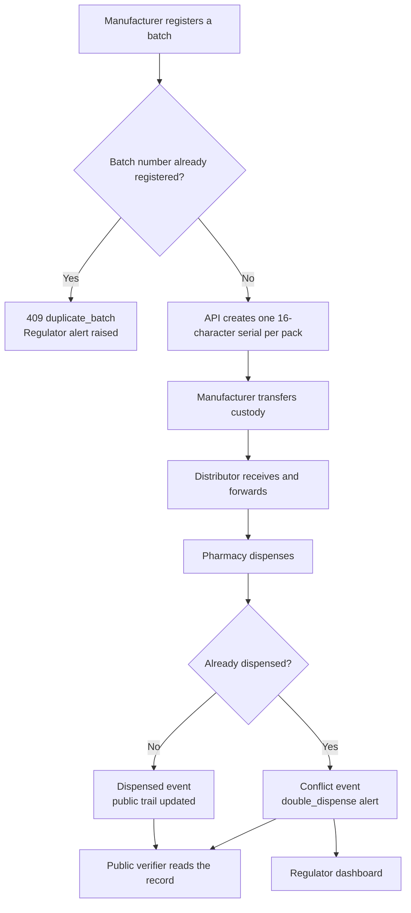
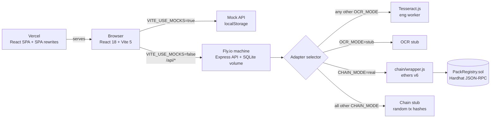
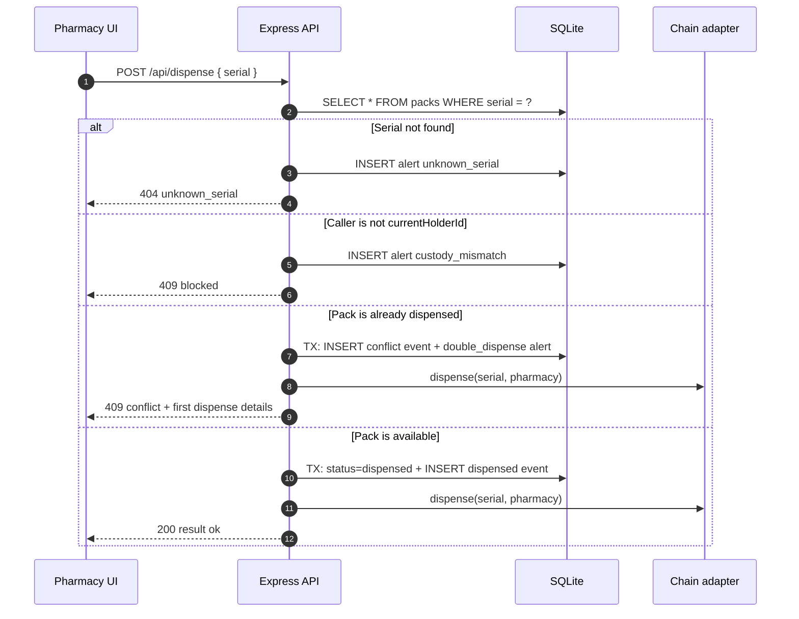
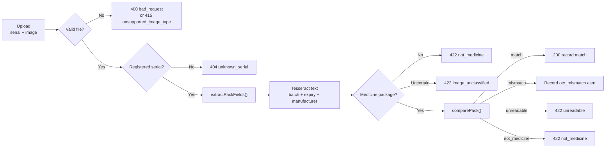
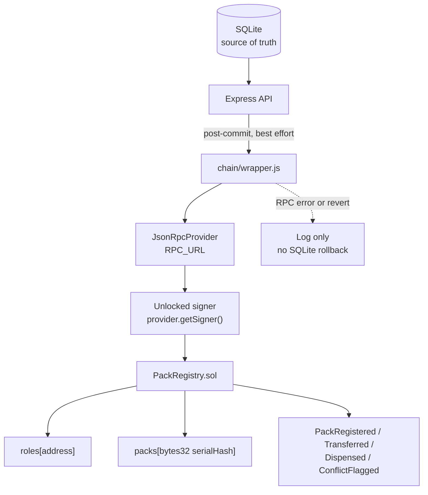
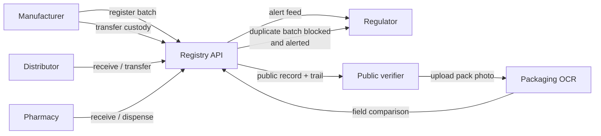
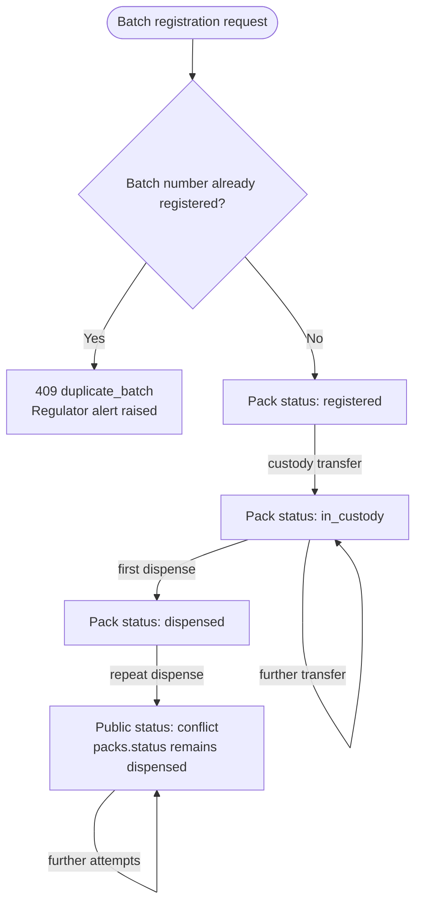

<div align="center">

# ZENTRIQ

**Medicine pack verification for a connected supply chain.**

Registry-backed serials · custody trails · duplicate-dispense detection · packaging OCR · optional EVM audit anchor

[Overview](#1-executive-summary--core-concept) · [Architecture](#2-system-architecture) · [Roles](#3-role--permission-venn--flow) · [Security](#4-cryptographic-security--red-team-defenses) · [Run](#5-local-setup--deployment) · [Authors](#-authors) · [Copyright](#-copyright--license)

</div>

> **Scope statement**
>
> ZENTRIQ checks that a pack serial exists in the registry and that the visible batch and expiry fields agree with the stored record. It does not test the medicine inside, establish that a package was manufactured by the named company, or replace laboratory or regulatory inspection.

---

## 1. Executive Summary & Core Concept

### 1.1 The problem

Medicine distribution records are often split across manufacturer systems, distributor manifests, pharmacy point-of-sale software, and paper-based inspection. That fragmentation makes four questions difficult to answer quickly:

1. **Does this pack serial exist in a central registry?**
2. **Which organisation currently holds it, and where?**
3. **Has it already been dispensed, or has a duplicate dispensing event occurred?**
4. **Do the batch number and expiry printed on the box match the registered batch?**

ZENTRIQ answers those questions with a small, inspectable system: a React verification portal, an Express + SQLite registry, a deterministic packaging-OCR path, and an optional blockchain mirror.

### 1.2 How it works



1. A **manufacturer** registers a batch and defines its product name, batch number, expiry, and quantity. A batch number that already exists is rejected with `409 duplicate_batch`, and the regulator alert feed is notified.
2. The API creates one **16-character pack serial** per unit and records a `registered` event.
3. A **custodian** transfers serials to a distributor or pharmacy; each transfer updates `currentHolderId` and appends a `transferred` event.
4. A **pharmacy** records a `dispensed` event. A repeat attempt is recorded as a conflict and raises a regulator alert.
5. A **public verifier** can look up a serial, inspect the custody trail, and upload a pack photograph for OCR field comparison.

### 1.3 What the system can and cannot answer

| It can answer | It cannot answer |
| --- | --- |
| Whether a serial has a registry record | Whether the medicine inside the pack has the labelled composition |
| The registered product, batch, and expiry | Whether the pack was physically produced by the named manufacturer |
| The current custodian and the recorded event trail | Whether a photograph or QR label has been copied from another pack |
| Whether a duplicate batch number or dispensing attempt was blocked | Whether a distributor or pharmacy is licensed in the real world |
| Whether readable batch and expiry text match the registry | Whether a pack has been stored under correct temperature conditions |
| Whether a serial is registered but has no custody movement yet | Whether the supply chain actor is who they claim to be beyond the demo session |

The public UI carries the same boundary in `web/src/strings.json`:

> “This check confirms a pack matches a registry record. It does not test the medicine inside.”

### 1.4 Design principles

| Principle | Implementation consequence |
| --- | --- |
| **Registry first** | SQLite is the operational source of truth. Blockchain writes are optional mirrors and do not decide API responses. |
| **Explicit state** | Packs move through `registered → in_custody → dispensed`; duplicate attempts produce `conflict` events and `double_dispense` alerts. |
| **Deterministic comparison** | OCR extraction is probabilistic, but comparison is a deterministic field check against the registered batch. |
| **Fail closed on uploads** | The OCR route refuses images that are not explicitly classified as medicine packaging. |
| **Small operational surface** | One API process, one SQLite file, one optional chain adapter, and one optional OCR worker. |
| **Demo-compatible defaults** | The frontend runs without a backend through a localStorage mock; the API seeds demo actors on first boot. |
| **Honest limits** | The UI, API, and this document distinguish registry matching from laboratory testing. |

### 1.5 Status lexicon

The UI and API intentionally use a narrow vocabulary. These labels are the product language; the underlying values are in the second column.

| Product label | API / storage value | Meaning |
| --- | --- | --- |
| **Registered by manufacturer** | `registered` | The pack serial exists and the manufacturer still holds it. |
| **In the supply chain, not yet dispensed** | `in_custody` | At least one custody transfer has been recorded; no dispense event exists. |
| **Dispensed** | `dispensed` | A pharmacy recorded a dispensing event. |
| **Conflict: needs review** | `conflict` | A `double_dispense` alert exists. In the real API this is a derived status; the pack row itself remains `dispensed`. |
| **No registered record found** | `unknown` | The serial does not exist in `packs`, or no record was returned. |
| **OCR Mismatch** | `mismatch` | Readable batch or expiry fields differ from the registered record. |
| **OCR Mismatch / unreadable** | `unreadable` | Required fields or confidence were insufficient for comparison. |

### 1.6 Personas

| Persona | Session required | Primary job |
| --- | --- | --- |
| **Manufacturer** | Yes | Register batches, create serials and QR codes, start custody. |
| **Distributor** | Yes | Scan or enter serials, receive stock, dispatch to pharmacies. |
| **Pharmacy** | Yes | Verify a serial, record dispensing, surface duplicate-dispense conflicts. |
| **Regulator** | Yes | Review the national alert feed and open linked pack records. |
| **Public verifier** | No | Look up a serial, inspect its trail, and compare a pack photo. |

The four session-gated personas map to `actors.role`. The public verifier has no actor row and no session.

---

## 2. System Architecture

### 2.1 Topology



**Operational reading of the diagram**

- The browser can run entirely against `web/src/mocks`; no API is required for a UI demo.
- When mocks are disabled, calls go to relative `/api/...` paths. Vite proxies those to `http://localhost:3001`; a deployed frontend uses `VITE_API_URL` as an origin.
- The API always talks to SQLite. Chain synchronization is a post-write side effect, not a second source of truth.
- OCR runs inside the API process through a lazily initialized Tesseract worker. The standalone `ocr/` package is a separate Gemini experiment and is not imported by `api/src`.
- The Docker image and Fly configuration set `CHAIN_MODE=stub` and `OCR_MODE=stub`. The chain contract is not shipped in the API image.

### 2.2 Runtime components

| Component | Path | Responsibility |
| --- | --- | --- |
| Verification portal | `web/` | Login, role dashboards, QR scanning, public verification, OCR upload, mock API. |
| HTTP API | `api/src/index.js` | Session lookup, batch registration, custody transfer, dispensing, public verification, OCR upload, alerts, error handling. |
| Schema and seed actors | `api/src/schema.js` | Table DDL, batch-number unique index, six demo actors, first-boot initialization. |
| OCR adapter | `api/src/ocr-tesseract.js` | Tesseract worker, text normalization, field extraction, classification, comparison. |
| Integration selector | `api/src/integrations.js` | Selects chain and OCR adapters from environment variables at module load. |
| Chain stub | `api/src/stubs/chain.js` | Returns random 32-byte transaction hashes without an EVM node. |
| OCR stub | `api/src/stubs/ocr.js` | Returns a dummy extraction payload. Note: the API’s classification gate rejects it. |
| Smart contract | `chain/contracts/PackRegistry.sol` | Relayer-controlled pack registry with role mapping, custody, dispensing, and conflict events. |
| Chain wrapper | `chain/wrapper.js` | Converts serials to `keccak256` bytes32 values and calls the local deployment. |
| Chain deploy script | `chain/deploy.js` | Deploys the contract, registers demo actor addresses, writes `deployments.json`. |
| Standalone OCR module | `ocr/` | Gemini-based extraction and comparison experiment; not wired into the API. |
| Demo evidence | `demo/` | Script, evidence log, slide outline, pack-design fixtures. |

### 2.3 Data model


> **Important:** these are logical relationships. `api/src/schema.js` declares **no `FOREIGN KEY` constraints**. The hard constraints are the `actors.id` and `batches.id` primary keys, the `packs.serial` primary key, the two auto-increment event/alert IDs, and a case-insensitive unique index on `batches.batchNo`. There are no other secondary indexes, so referential integrity is maintained by application code.

#### Table reference

| Table | Key fields | Purpose |
| --- | --- | --- |
| `actors` | `id`, `username`, `role`, `name`, `place`, `address`, `token` | Demo supply-chain organisations and their current session token. |
| `batches` | `id`, `productName`, `batchNo`, `expiry`, `quantity` | Registered batch metadata. `batchNo` has a case-insensitive unique index. There is no manufacturer column. |
| `packs` | `serial`, `batchId`, `status`, `currentHolderId` | One row per physical pack identity. `serial` is the human-readable 16-character identifier. |
| `events` | `packSerial`, `type`, `actorId`, `at`, `txHash`, `details` | Append-only trail for registration, transfer, dispensing, and conflict events. |
| `alerts` | `serial`, `type`, `at`, `details` | Regulator-facing risk records. |

#### Event types

| Type | Written by | Notes |
| --- | --- | --- |
| `registered` | Batch registration | One row per generated serial. `txHash` is filled after a chain call succeeds. |
| `transferred` | Custody transfer | `details` contains `{"to": <recipientActorId>}`. |
| `dispensed` | First successful dispense | One per pack under normal operation. |
| `conflict` | Duplicate dispense path | Written when the recorded current holder tries to dispense an already-dispensed pack. |

#### Alert types

| Type | Trigger | Details |
| --- | --- | --- |
| `unknown_serial` | Pharmacy dispenses an unregistered serial. | `null` |
| `custody_mismatch` | A pharmacy attempts to dispense a pack it does not currently hold. | `null` |
| `double_dispense` | The current holder attempts a second dispense. | `null` |
| `ocr_mismatch` | OCR comparison returns `mismatch`. | JSON containing `differences`. |
| `duplicate_batch` | A manufacturer attempts to register an existing batch number. | Human-readable message naming the existing product/batch and the blocked attempt; `serial` points at the existing batch’s first pack when available. |

#### Status derivation on public verification

`GET /api/verify/:serial` does not trust `packs.status` alone:

1. If any `double_dispense` alert exists for the serial → `conflict`.
2. Else if `packs.status = dispensed` → `dispensed`.
3. Else if `packs.status = in_custody` → `in_custody`.
4. Else if `packs.status = registered` → `registered`.
5. Else → `unknown`.

The real API never stores the literal status `conflict` in `packs.status`. The mock API does. This difference matters when comparing test fixtures.

### 2.4 HTTP API surface

All responses are JSON except the OCR request, which is multipart. The API enables `cors()` for all origins and accepts JSON bodies up to **1 MB**. Error responses use the shape `{ "error": string, "message": string, ...extra }`, except dispense responses that intentionally return domain results.

| Method | Path | Session | Request | Success | Main failures |
| --- | --- | --- | --- | --- | --- |
| `POST` | `/api/login` | Public | `{ username }` | `200 { token, actor }` | `400` missing username; `401` unknown user |
| `POST` | `/api/batches` | Bearer | `{ productName, batchNo, expiry, quantity }` | `201 { batchId, serials[] }` | `400` validation; `403` not manufacturer; `409` duplicate batch number; `500` database error |
| `POST` | `/api/custody/transfer` | Bearer | `{ serials[], toActorId }` | `200 { ok, transferred, txHashes[] }` | `400` validation/self-transfer; `403` not holder; `404` unknown serial; `409` already dispensed |
| `POST` | `/api/dispense` | Bearer | `{ serial }` | `200 { result: "ok", txHash, flags }` | `400` missing serial; `403` not pharmacy; `404` unknown serial; `409` blocked/conflict |
| `GET` | `/api/verify/:serial` | Public | Path parameter | `200` record or unknown record | `400` empty serial |
| `POST` | `/api/verify/ocr` | Public | Multipart `serial` + `image` | `200` comparison result | `400` missing file/serial; `404` unknown serial; `415` unsupported image; `422` not medicine/unreadable; `502` OCR unavailable/invalid |
| `GET` | `/api/alerts` | Bearer | Optional `?limit=` | `200` alert array | `403` not regulator |

**Session model**

- `POST /api/login` accepts a username only. There is no password field, password hash, or JWT.
- The API creates `crypto.randomUUID()` and stores it directly in `actors.token`.
- `Authorization: Bearer <token>` is looked up against that column on every gated request.
- Logging in again replaces the previous token for that actor.
- The frontend stores the token and actor in both `zentriq_token`/`zentriq_actor` and `token`/`actor` localStorage keys for compatibility.

**Role gates implemented by the API**

| Route | Gate |
| --- | --- |
| Batch registration | `actor.role === "manufacturer"` |
| Dispense | `actor.role === "pharmacy"` |
| Alerts | `actor.role === "regulator"` |
| Custody transfer | Valid session, valid recipient role, current holder, not already dispensed. The **sender role is not checked**. |

**Validation bounds**

| Input | Bound |
| --- | --- |
| Batch number | Non-empty after trim; compared case-insensitively; duplicate returns `409 duplicate_batch` |
| Batch quantity | Whole number from `1` to `10000` |
| Transfer batch | `1` to `500` serials; no duplicate strings; no empty strings |
| Transfer recipient | Existing actor whose role is `distributor` or `pharmacy`; not the sender |
| Alerts limit | Parsed integer clamped to `1..1000`; default `200` |
| OCR image | One file; `image/jpeg`, `image/png`, or `image/webp`; maximum `8 MiB`; memory storage |

### 2.5 Serial identity and entropy

`generateSerial()` in `api/src/index.js` is intentionally small:

```js
const alphabet = "0123456789ABCDEFGHJKMNPQRSTVWXYZ";
const bytes = crypto.randomBytes(16);
let serial = "";
for (let i = 0; i < 16; i += 1) {
  serial += alphabet[bytes[i] % alphabet.length];
}
return serial;
```

| Property | Value |
| --- | --- |
| Random source | Node `crypto.randomBytes(16)` |
| Source entropy | 128 bits (16 bytes) |
| Serial length | 16 characters |
| Alphabet size | 32 symbols: `0123456789ABCDEFGHJKMNPQRSTVWXYZ` |
| Bits per symbol | `log2(32) = 5` |
| Encoded serial space | `32^16 = 2^80` |
| Modulo bias | None for the mapping: `256 % 32 = 0` |
| Collision handling | None in the API generator. A collision would be rejected by the `packs.serial` primary key and surface as `500 database_error`. |
| Forbidden-word filtering | Implemented only in the frontend mock, not in the API generator. |

The API’s 128 source bits are reduced to an **80-bit serial space** by encoding one symbol per random byte. The correct description is “128 bits of random input, 16-character / 80-bit encoded serial,” not “128-bit serial.” The chance of a collision is small for a demo, but there is no retry loop on the server.

The frontend mock uses a different 32-symbol alphabet, `ABCDEFGHJKLMNPQRSTUVWXYZ23456789`, and does retry when a candidate contains a word from `strings.forbiddenWords` or already exists. Mock serials and API serials therefore have different character distributions.

**QR format**

The manufacturer dashboard renders:

```text
${window.location.origin}/v/${serial}
```

Scanners accept either a raw serial or a URL containing `/v/<serial>`, then uppercase the result. The server lookup itself is case-sensitive and only trims whitespace; API clients should send uppercase serials.

### 2.6 Custody and dispense behavior



**Custody transfer** performs all of these checks before writing:

1. `serials` is a non-empty array of at most 500 unique, non-empty strings.
2. `toActorId` is a positive integer and maps to a `distributor` or `pharmacy`.
3. The recipient is not the sender.
4. Every serial exists.
5. `packs.currentHolderId === req.actor.id` for every serial.
6. Every pack’s status is not `dispensed`.

The transfer write is a single `db.transaction()`: it updates `currentHolderId`, sets `status = in_custody`, and inserts one `transferred` event per serial. Chain calls happen after the transaction commits, one per serial. A chain failure is caught and logged; the HTTP response still reports success.

**Dispense ordering detail:** the real API checks current custody **before** checking the dispensed status. A different pharmacy attempting to dispense an already-dispensed pack therefore receives the custody-mismatch path, not the `double_dispense` conflict path. The recorded holder attempting again receives the conflict path. The mock API checks dispensed/conflict status first and does not check the holder at all.

**Chain synchronization is best effort.** Batch registration commits the batch and all packs first, then calls the chain once. Transfer and dispense commit locally first, then call the chain per serial. Chain failures do not roll back SQLite and do not change the success status of the local operation.

### 2.7 OCR pipeline



**Extraction details**

| Stage | Implementation |
| --- | --- |
| Worker | Lazy singleton `createWorker("eng", 1)`; progress logged while recognizing text. |
| Raw text normalization | Uppercase, remove non-printable bytes, collapse spaces. |
| Expected-value assistance | The route passes the registered batch record into extraction; the extractor can use expected batch and expiry to guide parsing. |
| Batch normalization | Uppercase; strip spaces/hyphens; replace `O → 0` and `I → 1`; require `A-Z0-9` length 3–40. |
| Expiry normalization | Supports `YYYY-MM[-DD]`, `DD/MM/YYYY`, `MM/DD/YYYY`, `MM/YYYY`, `MM/YY`, and named-month formats. |
| Manufacturer normalization | Remove parentheses, uppercase, strip non-alphanumerics. |
| Classification | `true` when batch or expiry was extracted (confidence `0.95`); otherwise require at least 2 of 8 packaging signals. |
| Dynamic confidence | `rawConfidence * 0.4 + fieldMatchCount/3 * 0.6`; boosted to at least `0.85` when the batch matches. |
| Comparison threshold | `0.6`. Missing batch, expiry, or registered values produce `unreadable`. |
| Mismatch alert | Only `mismatch` records an alert; `unreadable` and `not_medicine` do not. |

**The classification gate is fail-closed in the route, but the OCR stub does not satisfy it.** `api/src/stubs/ocr.js` returns `{ dummyField, confidence: 1 }` with no `isMedicinePackage` field. The route requires `fields.isMedicinePackage === true`, so a stub-mode upload always returns `422 image_unclassified`. To exercise field comparison, run the API with Tesseract (`OCR_MODE=real` or simply any value other than `stub`) or use frontend mock mode. The Docker image and Fly config default to `OCR_MODE=stub`, so this is the deployed behavior unless changed.

**Manufacturer comparison is currently inert.** `comparePack()` checks `registered.manufacturer`, but `batches` has no `manufacturer` column and the API passes the raw batch row. The extractor can return a manufacturer string, and the comparison code supports one, but the registered side is always `undefined` in the current API path. Batch and expiry are the enforced fields.

**OCR is not an assay.** It compares visible text with a stored row. A copied label, a high-quality reprint, or a clear photograph of another pack can still produce a field match. The system does not inspect composition, potency, or physical security features.

### 2.8 Blockchain audit overlay

The Solidity contract is a **relayer-controlled mirror**:



| Contract feature | Behavior |
| --- | --- |
| `Role` enum | `None`, `Manufacturer`, `Distributor`, `Pharmacy`, `Regulator`. |
| `relayer` | Set to the deployer. All state-changing functions are `onlyRelayer`. |
| `addActor` | Relayer assigns an EVM address a role. |
| `registerPacks` | Relayer registers `bytes32[]` serial hashes; rejects duplicate hashes. |
| `transfer` | Requires registered, not dispensed, current holder equals `from`, and recipient is a distributor or pharmacy. |
| `dispense` | Requires a pharmacy role. First call records the dispenser; later calls emit `ConflictFlagged` and return `false`. |
| `getPack` | Returns `registered`, `holder`, `dispensedBy`, `dispensedAt`. |

The wrapper hashes readable serials with `ethers.id(serial)` (keccak256 of the UTF-8 string). Raw serials are not stored on-chain. The deployment script writes `deployments.json` at the repository root and the wrapper reads only `deployments.localhost`, so the current real-chain path is local-Hardhat-oriented despite the existence of a Sepolia network entry in `hardhat.config.js`.

`CHAIN_MODE=real` loads `chain/wrapper.js`; every other value loads the stub. The Fly image does not copy `chain/`, so `CHAIN_MODE=real` in that image would fail at require time. This is why `fly.toml` pins `CHAIN_MODE=stub`.

The API does not reconcile chain state back into SQLite. If the chain rejects or misses an event, the local database remains authoritative and the UI continues to use it. Chain results are audit metadata, not a consensus gate.

### 2.9 Frontend architecture

| Area | Implementation |
| --- | --- |
| Build | Vite 5, React 18, `@vitejs/plugin-react`. |
| Routing | React Router 6, browser history. |
| Styling | Hand-authored `styles.css`, precompiled Tailwind utility output in `portal.css`, compatibility overrides in `index.css`. No Tailwind package or Tailwind build step is present in `web/package.json`. |
| Icons | `lucide-react`. |
| QR generation | `qrcode.react` (`QRCodeSVG`) in the manufacturer dashboard. |
| QR reading | `html5-qrcode` with camera and gallery-file decode. |
| Sessions | localStorage; `AuthProvider` keeps React state in sync. |
| Data access | Single `web/src/api.js` facade; switches between mock and HTTP calls. |
| Mocks | `web/src/mocks/index.js`, seeded by `web/src/mocks/seed.js`, persisted at `zentriq_mock_db_v1`. |

**Routes**

| Path | Component | Behavior |
| --- | --- | --- |
| `/` | `Home` | Redirects to `/dashboard` when a stored actor and token exist, otherwise `/login`. |
| `/login` | `Login` | Username-only demo login with four quick-login accounts. |
| `/dashboard` | `Dashboard` | Reads the stored actor and renders the role-specific dashboard. |
| `/verify` | `PublicVerify` | Empty public verification page. |
| `/verify/:serial` | `PublicVerify` | Loads a record by route parameter. |
| `/v/:serial` | `PublicVerify` | Short QR-friendly alias used by generated QR codes. |
| `/manufacturer`, `/distributor`, `/pharmacy`, `/regulator` | Redirect | All redirect to `/dashboard`. |
| `*` | Redirect | Redirects to `/`. |

`App.jsx` imports `SerialEntry.jsx`, but no route mounts it. The active pages are `Login`, `Dashboard`, and `PublicVerify`; the role experience lives in `web/src/components/*Dash.jsx`.

**Role dashboards**

| Dashboard | Implemented actions |
| --- | --- |
| Manufacturer | Register batch, generate 16-character serials, render and print QR cards, transfer custody, view persisted batch/log history. |
| Distributor | Auto-start camera scanner, upload a QR image, manually add serials, maintain a transfer queue, dispatch to a pharmacy, view session activity. |
| Pharmacy | Auto-start camera scanner, upload a QR image, manually enter a serial, dispense, show a full-screen conflict dialog with the prior dispenser and time. |
| Regulator | Fetch `/api/alerts`, sort newest first, render type/time/details/serial with links to `/v/:serial`. |

**Public verification page**

- Accepts a 16-character serial, a QR scan, or a `/v/<serial>` URL.
- Shows status, product, current custody, event timeline with transaction hashes, and registry flags.
- Supports camera capture or gallery selection for the OCR upload.
- Uses a pre-flight `navigator.mediaDevices.getUserMedia` capability check and releases the scanner on modal close/unmount.
- The status banner defaults to “No registered record found” before a query is made; this is the page’s initial render state, not a server response.

### 2.10 Mock mode versus the real API

The mock is a UI demo, not an authorization emulator. These differences are intentional enough to document because a demo that passes in mock mode may behave differently against the API.

| Behavior | Real API | Browser mock |
| --- | --- | --- |
| Default activation | Requires a running process. | `VITE_USE_MOCKS !== 'false'`, so mocks are on unless explicitly disabled. |
| Session storage | `actors.token` in SQLite. | `db.sessions[token]` inside localStorage-backed mock DB. |
| Login matching | Exact username after trim. | Lowercased lookup against `DEMO_USERNAMES`. |
| Batch quantity | `1..10000`. | `1..500`. |
| Batch role | Manufacturer only. | Manufacturer only. |
| Duplicate batch number | Rejected with `409 duplicate_batch`; regulator alert written; case-insensitive match. | Rejected with `409`; regulator alert written; case-insensitive match. |
| Transfer sender role | Not checked; sender must currently hold each serial. | Only a valid session is checked; no holder or sender-role check. |
| Transfer recipient | Must be distributor/pharmacy and not self. | Any existing actor; no role or self check. |
| Transfer result | Errors for unknown/not-held/dispensed serials. | Silently skips unknown, dispensed, or conflict records. |
| Dispense holder check | Required before dispensing. | Not checked. |
| Conflict ordering | Holder check happens before dispensed check. | Dispensed/conflict check happens first. |
| Conflict storage | `packs.status` stays `dispensed`; status is derived from `double_dispense` alert. | `rec.status = 'conflict'` is stored directly. |
| Alerts endpoint | Regulator role required. | No role check. |
| OCR | Tesseract extraction plus deterministic comparison. | Caller selects `match`, `mismatch`, or `unreadable`; no image analysis. |
| Serial generator | 16 random bytes, API alphabet, no retry. | 16 random bytes, mock alphabet, retry on forbidden words/collisions. |
| Seed data | Six actors, no packs. | Two seeded packs and one alert. |
| Seed usernames | `zenocare`, `afyalink`, `mlimani`, `kaaga`, `lakeview`, `regulator`. | Adds `kilimo` and `highland` aliases; quick-login shows four. |

Mock seed serials:

| Serial | Seeded state | Holder |
| --- | --- | --- |
| `K7Q2M9XW4TBH3N8D` | `in_custody` | Mlimani Pharmacy |
| `R4T8V2YC6DJH9PXM` | `conflict` with `double_dispense` alert | Mlimani Pharmacy |

### 2.11 Repository and source map

```text
medicine-verify/
├── api/                    Express + SQLite registry, OCR adapter, stubs, seed scripts
├── chain/                  Hardhat project, PackRegistry contract, wrapper, tests
├── demo/                   Demo script, evidence template, pack designs
├── ocr/                    Standalone Gemini OCR experiment and comparison tests
├── spec/                   Empty API/chain/OCR placeholders plus shared strings
├── web/                    React/Vite verification portal
├── .env.example            Root environment template (not auto-loaded by the API)
├── fly.toml                Fly.io API deployment with SQLite volume
└── README.md               This document
```

| Question | Look at |
| --- | --- |
| How is a serial generated? | `api/src/index.js` → `generateSerial()` |
| How is login handled? | `api/src/index.js` → `POST /api/login`, `requireAuth` |
| How is custody transferred? | `api/src/index.js` → `POST /api/custody/transfer` |
| How is a conflict detected? | `api/src/index.js` → `POST /api/dispense`, `GET /api/verify/:serial` |
| How is a duplicate batch blocked? | `api/src/index.js` → `POST /api/batches`, `rejectDuplicateBatch()`; `api/src/schema.js` → unique `batchNo` index |
| How is OCR classified? | `api/src/ocr-tesseract.js` → `classifyMedicinePackage()` |
| How are fields compared? | `api/src/ocr-tesseract.js` → `comparePack()` |
| What tables exist? | `api/src/schema.js` |
| How does the frontend choose data? | `web/src/api.js` → `USE_MOCKS` |
| What does the mock seed contain? | `web/src/mocks/seed.js` |
| How does the contract enforce custody? | `chain/contracts/PackRegistry.sol` |
| How does the API call the chain? | `chain/wrapper.js`, `api/src/integrations.js` |
| How is the API deployed? | `api/Dockerfile`, `fly.toml` |
| How is the frontend deployed? | `web/vercel.json`, `web/vite.config.js` |

---

## 3. Role & Permission Venn / Flow

### 3.1 Role flow



### 3.2 Capability matrix

| Capability | Public | Manufacturer | Distributor | Pharmacy | Regulator |
| --- | :---: | :---: | :---: | :---: | :---: |
| Log in with a demo username | — | Yes | Yes | Yes | Yes |
| Register a batch and generate serials | — | **Yes** | — | — | — |
| Hold custody | — | Yes, at origin | Yes | Yes | — |
| Transfer custody | — | Holder only | Holder only | Holder only via API | — |
| Dispense a pack | — | — | — | **Yes** | — |
| Read public pack record and trail | **Yes** | Yes | Yes | Yes | Yes |
| Upload a pack photo for OCR comparison | **Yes** | Yes | Yes | Yes | Yes |
| Read the alert feed | — | — | — | — | **Yes** |
| See regulator alerts in a dashboard table | — | — | — | — | **Yes** |
| Mutate a pack record | — | Register/transfer | Transfer | Dispense | — |

### 3.3 Boundary overlaps and gaps

The roles overlap in ways that matter for both UX and security review:

| Overlap | What actually happens |
| --- | --- |
| **Manufacturer ∩ Distributor: transfer** | Both can call the transfer endpoint. The API does not check the sender’s role; it checks that the sender currently holds each serial. |
| **Distributor ∩ Pharmacy: receiving** | Both are valid recipients. A distributor can transfer to another distributor or a pharmacy; a manufacturer can also transfer directly to a pharmacy. |
| **Pharmacy ∩ Public: verification** | A logged-in pharmacy can use the public verification page; the public endpoints need no session. |
| **Regulator ∩ Public: record inspection** | Regulator alert rows link to `/v/:serial`, which is the same public page. Regulators cannot mutate a pack from the alerts table. |
| **Manufacturer ∩ Registry: origin** | Only a manufacturer can create a batch, but any session-gated current holder can transfer it afterward. |
| **All session-gated roles ∩ Public** | Gated users can call public endpoints; public users cannot call gated endpoints. |
| **Intended path vs enforced path** | The UI presents `Manufacturer → Distributor → Pharmacy`, but the transfer API allows `Manufacturer → Pharmacy` and `Distributor → Distributor`. |
| **Pharmacy transfer gap** | The pharmacy dashboard has no transfer action, but the API would accept a transfer from a pharmacy that is the current holder. Sender-role restrictions are not implemented for transfers. |

**Self-transfer is explicitly rejected.** A holder cannot transfer to its own actor ID. Transfers to a manufacturer or regulator are rejected because the recipient role must be `distributor` or `pharmacy`.

### 3.4 Pack lifecycle



Side paths that do not change the pack state:

- A duplicate batch number produces a `409 duplicate_batch`, a regulator alert, and no new batch or pack state.
- An unknown serial produces a `404` and an `unknown_serial` alert; no pack state exists.
- A non-holder dispense attempt produces a `409 blocked` and a `custody_mismatch` alert; the pack state is unchanged.
- An OCR mismatch produces an `ocr_mismatch` alert; the pack status is unchanged.
- A chain failure produces a log entry; SQLite state is unchanged from the API’s perspective.

### 3.5 Boundary of the public experience

The public page is deliberately read-mostly. It can:

- look up a serial,
- display product and current holder,
- display the chronological trail,
- display registry flags,
- compare a photo against the registered batch fields.

It cannot:

- register, transfer, or dispense,
- see the regulator alert feed as a list,
- distinguish a copied QR label from an original one,
- prove that the photographed pack is the same physical unit as the serial.

### 3.6 Demo accounts

The API seeds six actors on first database initialization. The login screen exposes four quick-login buttons; the other two are available by typing their usernames.

| Username | Actor ID | Role | Name | Place |
| --- | ---: | --- | --- | --- |
| `zenocare` | 1 | Manufacturer | Zenocare Labs (demo) | Nairobi |
| `afyalink` | 2 | Distributor | AfyaLink Distributors (demo) | Nairobi |
| `mlimani` | 3 | Pharmacy | Mlimani Pharmacy (demo) | Meru |
| `kaaga` | 4 | Pharmacy | Kaaga Chemist (demo) | Meru |
| `lakeview` | 5 | Pharmacy | Lakeview Pharmacy (demo) | Kisumu |
| `regulator` | 6 | Regulator | Demo Regulator | Nairobi |

No password is required by design. The API source contains an explicit comment that username-only session handling is not suitable for production.

### 3.7 Role-specific UI behavior

| UI surface | Important behavior |
| --- | --- |
| Login | Four quick-login buttons plus free-text username. A stored actor redirects to `/dashboard`. |
| Dashboard shell | Reads `actor`/`zentriq_actor` from localStorage, renders the matching dashboard, and clears localStorage on logout. |
| Manufacturer | Persists created batches and logs in localStorage so a reload can repopulate the transfer form. QR values point at `/v/<serial>`. |
| Distributor | Camera auto-starts on mount. The queue only accepts 16-character normalized serials. Transfer recipient defaults to actor 3. |
| Pharmacy | Camera auto-starts. A successful dispense increments a session counter; a conflict opens a blocking modal with the prior dispenser and time. |
| Regulator | Pulls the alert feed on mount and refreshes it every five seconds. Duplicate-batch blocks get a banner and a `duplicate_batch` → “Duplicate batch blocked” table row. |
| Public | Search/scan/photo. The pack-photo section is always rendered, but an upload is rejected until a current serial has been resolved. |


---

## 4. Cryptographic Security & Red Team Defenses

> This section separates **implemented controls** from **production requirements**. It is an engineering threat model, not a certification or a claim that the prototype is ready for clinical deployment.

### 4.1 Assets, actors, and trust boundaries

| Asset | Why it matters | Where it lives |
| --- | --- | --- |
| Serial → batch mapping | Ties a physical identifier to one registered product record. | `packs`, `batches` |
| Custody trail | Shows who recorded each handoff and when. | `events` |
| Session tokens | Grant access to role-gated actions. | `actors.token`, browser localStorage |
| Regulator alerts | Surface unknown serials, custody mismatches, duplicates, and OCR mismatches. | `alerts` |
| OCR comparison result | Determines whether visible fields agree with the registry. | Computed in `api/src/ocr-tesseract.js` |
| Chain mirror | Optional audit anchor for registration, transfer, and dispensing. | `PackRegistry.sol`, `deployments.json` |
| Availability | Public verification and pharmacy dispensing are latency-sensitive. | Fly machine, SQLite volume, Tesseract worker |

| Trust boundary | What crosses it | Default posture |
| --- | --- | --- |
| Browser → API | JSON, multipart images, bearer tokens, serials | Untrusted input; CORS is open; validation is application-level. |
| API → SQLite | SQL statements and local file access | Trusted process; no database-level row security. |
| API → OCR worker | Image bytes and extracted text | Untrusted image content; Tesseract parser is in-process. |
| API → EVM node | Signed relayer transactions | Trusted relayer; local JSON-RPC by default. |
| Operator → deployment | Environment variables and volume contents | No secrets manager or key rotation in the repository. |
| Public → public pages | Serial lookups and photo uploads | No session required by design. |

| Adversary | Relevant capability |
| --- | --- |
| Public scanner | Can query any serial and upload images; can enumerate known/leaked identifiers. |
| Session-gated actor | Can call endpoints outside the UI, including transfers the UI does not expose. |
| Token thief | Can replay a bearer token until it is replaced or the database is reset. |
| Label copier | Can copy a valid QR code and printed fields onto another box. |
| Image adversary | Can submit unrelated, doctored, blurry, oversized, or parser-stressing images. |
| Network observer | Can see traffic if TLS is not enforced; local development uses HTTP. |
| Chain relayer compromise | Can write arbitrary role assignments and pack events to the contract. |
| Operator error | Can reset the database, expose a volume, mis-set `VITE_USE_MOCKS`, or deploy the OCR stub. |

### 4.2 Serial entropy and identifier threats

| Quantity | Calculation | Result |
| --- | --- | --- |
| Random input | 16 bytes × 8 bits | 128 bits |
| Alphabet | `0123456789ABCDEFGHJKMNPQRSTVWXYZ` | 32 symbols |
| Bits per serial character | `log2(32)` | 5 bits |
| Serial length | Fixed by loop | 16 characters |
| Encoded serial space | `32^16` | `2^80` ≈ 1.21 × 10²⁴ |
| Modulo bias | `256 % 32 = 0` | None for this mapping |
| Server collision retry | None | A duplicate hits the `packs.serial` primary key and becomes a database error |
| Mock collision retry | Re-rolls on collision or forbidden word | Implemented in `web/src/mocks/seed.js` |

For context, the birthday approximation `N² / (2 × 2⁸⁰)` gives a collision probability of roughly `4.1 × 10⁻¹³` at one million generated serials and `4.1 × 10⁻¹¹` at ten million. The practical constraint is not guessing; it is copying a serial or QR code that is already public.

**Key distinction**

- A serial is an **identifier**, not a secret and not a signature.
- Entropy makes blind enumeration expensive. It does not bind the identifier to a physical package.
- Printing a QR code that points to `/v/<serial>` exposes the identifier to anyone who can see or photograph the pack.
- The server does not compare a photographed serial with the serial encoded in the QR code; it verifies the submitted serial and separately compares OCR fields.

### 4.3 Session and permission controls

| Control | Implementation | Assessment |
| --- | --- | --- |
| Login | `POST /api/login` with `username` only | Demo-only; no password, account recovery, or identity proof. |
| Token generation | `crypto.randomUUID()` | UUID v4 has 122 random bits; adequate as a demo bearer value. |
| Token storage | Plain `TEXT` in `actors.token` | No hash, expiry, scope, or rotation history. |
| Token replacement | A new login overwrites the actor’s previous token | Old token becomes invalid only when a replacement is written. |
| Logout | Frontend clears localStorage | No server-side revocation endpoint; the database token remains valid. |
| Bearer extraction | Exact `Authorization: Bearer <token>` prefix | Missing, blank, or unknown tokens return `401 unauthorized`. |
| Batch permission | `actor.role === "manufacturer"` | Enforced. |
| Dispense permission | `actor.role === "pharmacy"` | Enforced. |
| Alert permission | `actor.role === "regulator"` | Enforced. |
| Transfer permission | Session, recipient role, current holder, not dispensed | Sender role is **not** restricted; see the transfer gap below. |
| Transfer gap | A pharmacy holding a pack can call transfer directly | The UI does not expose it, but the API permits it because the sender role is not checked. |
| Public verification | No session | Intentional read-only surface. |
| CORS | `cors()` with no origin allowlist | Any web origin can call the API if it has a valid token. |
| CSRF | Bearer token in localStorage, not an ambient cookie | Cookie-style CSRF is not the primary concern; XSS is. |
| Security headers | None configured in Express | No Helmet, CSP, HSTS, or frame policy at the application layer. |
| Login throttling | None | Username guessing and token probing are not rate-limited. |

**Token lifecycle reality:** the API is stateless on the request path except for the database lookup, but the token itself is stateful in `actors.token`. There is no expiry timestamp, no refresh token, no per-device session table, and no server logout. Resetting the database removes all tokens; changing an actor’s token by logging in again invalidates the prior token.

**Browser storage:** `web/src/api.js` writes the token and actor under both `zentriq_token`/`zentriq_actor` and `token`/`actor`. Any script executing in the page origin can read both. The dashboard logout path calls `localStorage.clear()`, which also removes mock data and locally persisted activity logs, not just the session.

### 4.4 Registry integrity and transaction atomicity

| Operation | Local transaction scope | External side effect | Rollback behavior |
| --- | --- | --- | --- |
| Batch registration | `batches` row + all `packs` rows + all `registered` events | One chain `registerPacks` call | SQLite transaction rolls back on local error. Chain failure is caught after commit and does not undo the batch. |
| Custody transfer | All `packs` holder/status updates + all `transferred` events | One chain `transfer` per serial | SQLite transaction rolls back on local error. Chain failures are logged per call; local success remains. |
| First dispense | `packs.status = dispensed` + `dispensed` event | One chain `dispense` call | SQLite transaction rolls back on local error. Chain failure does not undo dispensing. |
| Duplicate dispense | `conflict` event + `double_dispense` alert | One chain `dispense` call | Conflict transaction rolls back on local error. Chain failure does not remove the conflict record. |
| Duplicate batch registration | No batch/pack write; one `duplicate_batch` alert | None | Existing batch remains unchanged; the API returns `409` with a clear message. |
| OCR mismatch | Alert insert only | None | No surrounding transaction; a failure is logged. |

`better-sqlite3` is synchronous. In a single Node process, the check-then-write sequences in transfer and dispense are not interleaved by another request because no `await` occurs between the checks and the transaction. That is the practical race protection. It is **not** a database-enforced compare-and-swap:

- The transfer pre-checks are outside `db.transaction()`.
- The dispense checks are outside the write transaction.
- The update statements do not include `WHERE status = ...` guards.
- There is no unique constraint on `events` to prevent repeated identical events.
- Running multiple API processes against the same SQLite file would create a check-then-write race window.

**Schema integrity gaps**

| Gap | Consequence |
| --- | --- |
| No foreign keys | Orphaned packs, events, or alerts are possible after manual database edits. |
| `actors.username` is not `UNIQUE` | Duplicate usernames are possible outside the seed path; login uses a single-row lookup. |
| `actors.token` is not `UNIQUE` or indexed | Shared tokens and slow lookups are possible; the demo seed does not create duplicates. |
| Historical duplicate `batches.batchNo` rows | New duplicates are blocked by the application check and a case-insensitive unique index. Existing duplicate rows must be cleaned manually; index creation is best-effort and logs a warning if it fails. |
| No other secondary indexes | `events.packSerial` and `alerts.serial` scans grow with table size. |
| No migrations | Schema changes require manual handling; `ensureInitialized` only checks whether tables exist. |
| No backup or WAL policy in code | Recovery depends on the deployment’s volume practices. |

### 4.5 OCR threat model

| Threat | Implemented control | Residual risk |
| --- | --- | --- |
| Unrelated image (person, food, scenery) | Route requires `isMedicinePackage === true`; false returns `422 not_medicine`. | Classification is heuristic and image-dependent. |
| Fuzzy or ambiguous image | Missing `isMedicinePackage` returns `422 image_unclassified`; `comparePack` returns `unreadable` below `0.6`. | A clear but misleading image can still pass. |
| Doctored expiry or batch print | Deterministic normalization and field comparison; mismatch records an `ocr_mismatch` alert. | A copied label or a convincing reprint can match the record. |
| Expected-value bias | Extraction receives the registered batch/expiry and can prefer expected tokens found in the image. | This can mask a difference if expected tokens appear elsewhere on the packaging; comparison is not a blinded test. |
| Manufacturer mismatch | Comparison code supports a registered manufacturer. | The API passes no registered manufacturer because `batches` lacks the column, so this check is inert. |
| Oversized upload | Multer caps one file at 8 MiB and buffers it in memory. | No image-dimension limit, decompression-bomb guard, or decoder timeout. |
| Wrong file type | MIME allowlist for JPEG/PNG/WebP. | MIME is client-declared; the API does not inspect magic bytes. |
| Parser stress | Tesseract worker is a lazy singleton. | No queue, per-request timeout, concurrency limit, or CPU budget; OCR is a public endpoint. |
| Repeated mismatches | Each mismatch inserts an alert. | No deduplication or alert rate limit; a caller can grow the alert table. |
| Stub deployment | `OCR_MODE=stub` selects the stub. | The stub lacks `isMedicinePackage`, so every upload is rejected with `422 image_unclassified`; this is the Docker/Fly default. |

**OCR result semantics**

- `match` means readable batch and expiry agree with the stored batch. It does not mean the physical medicine is correct.
- `mismatch` means at least one compared field differs. It is still an HTTP `200` response with a domain result and an alert.
- `unreadable` means the required fields or confidence were insufficient. It returns `422`.
- `not_medicine` means the classifier rejected the image. It returns `422`.
- OCR text is normalized before comparison: batch separators are removed, `O`/`I` confusion is normalized, and expiry dates are reduced to year-month.

### 4.6 Chain trust model

The chain contract provides a **relayer-attested audit trail**, not independent actor signatures.

| Property | Reality |
| --- | --- |
| Who submits transactions? | The API process via `chain/wrapper.js` and `provider.getSigner()`. |
| Who authorizes writes? | The contract’s `relayer` address; every mutating function is `onlyRelayer`. |
| Do manufacturers/pharmacies sign? | No. Their demo addresses are passed as arguments; the relayer signs the transaction. |
| Is the relayer key handled by the API? | Not in the wrapper. It relies on an unlocked JSON-RPC signer. `chain/index.js` is a separate implementation that does use `PRIVATE_KEY`, but the API does not import it. |
| Which network does the wrapper use? | It always reads `deployments.localhost`; `CHAIN_NETWORK` is not consulted by the wrapper. |
| Is chain state reconciled? | No. SQLite remains the source of truth even if the chain rejects or misses an event. |
| Can the API report success after a chain failure? | Yes. Chain exceptions are logged and the local response is still success. |
| What happens if the relayer is compromised? | The attacker can assign roles and submit arbitrary pack transitions within the contract’s rules. |
| Is there an upgrade or pause path? | No; the contract is immutable and has no pause function. |

On-chain hashes are `keccak256(utf8(serial))` via `ethers.id()`. The contract stores `bytes32` hashes, not raw serials. The deployment script seeds the same six demo addresses used by the API actor seed.

### 4.7 Input validation and injection resistance

| Area | Implemented behavior | Gap |
| --- | --- | --- |
| SQL injection | All dynamic values use prepared statements and bound parameters. | No raw SQL construction from user input was found in the request paths. |
| JSON body size | `express.json({ limit: "1mb" })`. | Large batch arrays are bounded by route logic, but string field lengths are not explicitly capped. |
| Batch fields | `productName`, `batchNo`, and `expiry` must be non-empty strings after trim. `batchNo` is checked case-insensitively against existing batches, with a unique index as a second guard. | `expiry` is not parsed or validated as a date; any non-empty string is stored. |
| Quantity | Whole-number integer from `1` to `10000`. | No per-account quota or total-storage quota. |
| Transfer serials | Non-empty array, at most 500, unique non-empty strings. | No format check against the 16-character alphabet. |
| Recipient | Positive whole-number actor ID, existing actor, distributor/pharmacy, not self. | Sender role is not checked. |
| Alerts limit | Parsed integer clamped to `1..1000`, default `200`. | No pagination or cursor; older alerts become unreachable through this route beyond the limit. |
| OCR file | One file, 8 MiB maximum, MIME allowlist, memory storage. | No magic-byte validation, image dimension limit, or malware scanning. |
| Serial input | Trimmed; empty serial rejected. | Case-sensitive; no uppercase normalization server-side. |
| Path traversal | No user-controlled filesystem paths. | `DB_FILE` is operator-controlled. |
| Command injection | No shell execution from request data. | Not applicable in the request path. |
| SSRF | No user-supplied URLs are fetched. | Chain `RPC_URL` is operator-controlled. |

### 4.8 Red-team matrix

| Attack | Attempted path | Current control | Residual risk |
| --- | --- | --- | --- |
| **Serial enumeration** | Query `/api/verify/:serial` across the `2⁸⁰` space. | Large encoded space; no useful ordering. | Leaked or printed serials expose holder names, places, and trails; no rate limit. |
| **Duplicate batch registration** | Resubmit an existing batch number with changed case or whitespace. | Trimmed, case-insensitive lookup, `409 duplicate_batch` response, regulator alert, and a unique index guard. | Historical duplicate rows are not merged automatically; the index is best-effort on an existing database. |
| **QR/label copying** | Copy a valid QR and printed batch/expiry onto another box. | Registry lookup and OCR field comparison. | The clone can match the record; there is no physical binding or serial-to-QR comparison. |
| **Token replay** | Use a stolen bearer token from localStorage. | Token is required for gated routes. | No expiry or server logout; token remains valid until replaced/reset. |
| **Role escalation via API** | Call `/api/batches`, `/api/dispense`, or `/api/alerts` as the wrong role. | Explicit role checks on those routes. | Transfer sender role is not checked; a holder can transfer outside the intended UI path. |
| **Double dispense (same holder)** | Dispense the same serial twice as the recorded holder. | Conflict event + `double_dispense` alert; chain conflict event. | The conflict is recorded, not prevented; the UI must stop the handoff. |
| **Double dispense (different pharmacy)** | Dispense a pack held by another pharmacy. | Current-holder check returns `409 blocked` and records `custody_mismatch`. | This is not a `double_dispense` conflict; the UX language must distinguish the two. |
| **Concurrent dispensing** | Fire two dispense requests at once. | Single-process synchronous checks and transactions. | Multi-process or horizontal scaling can race because there is no conditional update. |
| **SQL injection** | Inject SQL through login, batch, transfer, dispense, or serial fields. | Prepared statements. | No evidence of dynamic SQL injection in the request path. |
| **Unrelated image** | Upload a photo of an object that is not medicine. | Classification gate; fail-closed route. | Classifier false positives; stub mode rejects every upload. |
| **Doctored expiry** | Photograph a pack with a changed expiry. | OCR extraction + deterministic comparison + mismatch alert. | Expected-value assistance and copied labels can reduce detection. |
| **Image parser abuse** | Submit an image designed to consume CPU/memory or exploit a decoder. | 8 MiB cap and MIME allowlist. | No dimension limit, timeout, queue, or sandbox boundary. |
| **Alert flooding** | Repeated OCR mismatches or failed dispense requests. | Alerts are recorded. | No per-serial dedupe and no write rate limit; storage can grow. |
| **Chain divergence** | Block or fail chain RPC after a local write. | Chain errors are logged; SQLite remains authoritative. | No outbox/reconciliation; the audit mirror can silently lag. |
| **Relayer compromise** | Use the relayer key to write arbitrary contract state. | `onlyRelayer` limits writers to one address. | That one address is a single point of trust; there is no multi-signature or actor signature. |
| **Mock-mode confusion** | Ship the frontend with mocks enabled and mistake it for the API. | `VITE_USE_MOCKS` is explicit; mock DB is separate. | Mocks are on by default; a deployment that forgets `false` will not touch the registry. |
| **Session theft via XSS** | Execute script in the portal origin and read localStorage. | React escapes rendered strings; no `dangerouslySetInnerHTML` was found in the reviewed pages. | No CSP or security headers; any future XSS can read both token keys. |
| **Privacy enumeration** | Query public records to map facilities and movements. | No session required; by design. | Holder names, places, and timelines are public; there is no redaction policy. |
| **Database disclosure** | Read the SQLite file or volume. | Filesystem permissions from the host/container. | No application-level encryption; actor tokens and the full trail are readable. |

### 4.9 Production hardening roadmap

| Priority | Change | Why |
| --- | --- | --- |
| **P0** | Replace username-only login with an identity provider or password login using Argon2id/scrypt, expiring sessions, revocation, and per-device records. | The current login is explicitly a demo compatibility path. |
| **P0** | Add API rate limits and per-route quotas for login, public verify, OCR, and alerts. | Public endpoints and CPU-heavy OCR are currently unthrottled. |
| **P0** | Restrict CORS to known frontend origins; add security headers, CSP, and HSTS at the edge. | `cors()` currently allows every origin. |
| **P0** | Add image magic-byte checks, dimension limits, decode timeouts, and an OCR work queue. | The current upload path trusts MIME and buffers up to 8 MiB in memory. |
| **P0** | Add foreign keys, remaining unique constraints, conditional updates, migrations, and a documented backup/restore procedure. | SQLite still relies on application discipline for most relationships; only `batchNo` has a unique index. |
| **P0** | Add an outbox or reconciliation job for chain writes, or remove the chain from the operational path. | Chain failures currently diverge silently from SQLite. |
| **P0** | Add CI covering API route tests, frontend build, chain tests, and OCR comparison tests. | No GitHub workflow exists; API coverage currently starts with the duplicate-batch regression test. |
| **P1** | Add a `manufacturer` column to `batches` and enforce manufacturer comparison. | The comparison code supports it, but the registered value is missing. |
| **P1** | Require actor signatures for chain writes instead of relayer-attested arguments. | On-chain data currently attests to the relayer, not the named actor. |
| **P1** | Deduplicate alerts and paginate the regulator feed. | Repeated mismatches and a 1000-row cap otherwise hide history. |
| **P1** | Define a privacy policy for public holder/place/trail exposure. | The public page exposes organisation movement data. |
| **P1** | Add structured logging, metrics, and alerting around OCR latency, chain failures, and 5xx rates. | The current system logs to process stdout. |
| **P2** | Move to a multi-writer database or a single-writer service with horizontal API scaling. | SQLite on one volume constrains deployment topology. |
| **P2** | Add key management, rotation, and encrypted secret storage. | Environment variables are the only secret mechanism in the repository. |
| **P2** | Commission an independent security review and a clinical/regulatory review. | The current scope is a prototype and registry demonstration. |

### 4.10 Privacy and data handling

- The registry stores organisation names, places, and EVM-style demo addresses. It does **not** store patient names, prescriptions, or clinical records.
- A dispense event records the pharmacy actor and timestamp, not the patient.
- Public verification exposes the current holder, place, event timeline, and transaction hashes. Treat serials as shareable identifiers, not private data.
- Alert details can contain OCR differences, which may include batch/expiry strings.
- Tokens are stored in localStorage and in plaintext in SQLite. Browser extensions or scripts in the origin can read them.
- There is no data-retention, deletion, export, or redaction workflow in the application.
- The Fly volume and database file rely on platform/disk controls; the application does not encrypt fields itself.

### 4.11 Security claims this repository supports

| Claim | Supported? | Qualification |
| --- | --- | --- |
| Serials use a cryptographic random source | Yes | `crypto.randomBytes(16)`; 80-bit encoded space. |
| SQL statements are parameterized | Yes | Request-path inserts/selects/updates use bound parameters. |
| Batch registration is atomic in SQLite | Yes | Single `db.transaction()` for batch, packs, and events. |
| Transfer is atomic in SQLite | Yes | Single transaction for pack updates and events. |
| Duplicate dispensing by the same holder is recorded | Yes | Conflict event + `double_dispense` alert. |
| Duplicate dispensing by a different holder is recorded as a conflict | No | It follows the custody-mismatch path instead. |
| Sessions are production-grade | No | Username-only login, non-expiring plaintext tokens. |
| The API is protected against abuse | No | No rate limits, open CORS, no security headers. |
| OCR proves the medicine is correct | No | It compares visible fields with one registry row. |
| The chain independently proves actor intent | No | The relayer submits every write. |
| The database is tamper-evident | No | No hash chain, signing, or append-only audit service beyond the schema. |
| The deployment supports multiple API writers | No | SQLite volume plus check-then-write logic assumes a single process. |


---

## 5. Local Setup & Deployment

### 5.1 Prerequisites

| Requirement | Notes |
| --- | --- |
| Node.js 20 LTS | `.nvmrc` contains `20`; `web/package.json` requires `>=20`; `ocr/package.json` declares `20.x`. |
| npm | All packages use npm lockfiles; `npm ci` is preferred for reproducible installs. |
| Native build tools | `better-sqlite3` may compile from source if a prebuilt binary is unavailable. Install `python3`, `make`, and a C++ compiler (`g++` on Debian/Ubuntu). |
| Git | For branch/PR workflows and for viewing the exact commit under review. |
| Docker | Optional; required only for testing the Fly-style image locally. |
| Fly CLI | Optional; required only for Fly deployment. |
| Camera access | Browsers require HTTPS or `localhost` for `getUserMedia`. Production hosting is HTTPS; local Vite on `localhost` is accepted. |
| Outbound network for real OCR | Tesseract.js may need to fetch language data on first use. |

### 5.2 Fast path: frontend-only mock demo

The mock API is the lowest-friction way to see the product. It needs no backend, database, chain, or OCR worker.

```bash
cd web
npm ci
npm run dev
```

Vite prints a local URL, normally `http://localhost:5173`.

**Default behavior**

- Mocks are on by default: `web/src/api.js` disables them only when `VITE_USE_MOCKS` is exactly the string `"false"`. The ignored local `web/.env` also sets `VITE_USE_MOCKS=true`.
- Login accepts the four quick-login usernames: `zenocare`, `afyalink`, `mlimani`, `regulator`.
- The mock DB seeds two serials:
  - `K7Q2M9XW4TBH3N8D` — in custody at Mlimani Pharmacy.
  - `R4T8V2YC6DJH9PXM` — conflict state with a `double_dispense` alert.
- Mock state persists at `localStorage["zentriq_mock_db_v1"]`.

Reset the mock database from the browser console:

```js
localStorage.removeItem('zentriq_mock_db_v1');
location.reload();
```

Logging out through the dashboard also calls `localStorage.clear()` and therefore resets the mock database, session, and locally persisted activity logs.

### 5.3 Full local stack with the real API

Use two terminals.

**Terminal 1 — API**

```bash
cd api
npm ci
CHAIN_MODE=stub OCR_MODE=stub npm run dev
```

The API listens on `http://localhost:3001` by default. On first boot it creates the database at `api/data/demo.db` and seeds the six demo actors. Startup output includes:

```text
Server listening on port 3001
OCR implementation: STUB
```

The second line is only accurate for `OCR_MODE=real`; see the quirks section below. The actual adapter is selected in `api/src/integrations.js`.

**Terminal 2 — frontend against the API**

```bash
cd web
npm ci
printf 'VITE_USE_MOCKS=false\nVITE_API_URL=\n' > .env.local
npm run dev
```

Vite proxies `/api` to `http://localhost:3001` because `web/vite.config.js` defines that proxy. Restart the Vite dev server after changing `.env.local`; Vite reads environment variables at startup/build time.

If you prefer not to create `.env.local`:

```bash
VITE_USE_MOCKS=false VITE_API_URL= npm run dev
```

**Why `VITE_API_URL` is empty locally:** frontend requests already include the `/api` prefix. An empty base URL keeps relative calls (`/api/verify/...`) and lets the Vite proxy handle the origin. Setting `VITE_API_URL=/api` produces `/api/api/...`.

**The API does not automatically load `api/.env`.** `dotenv` is a dependency, but `api/src/index.js` never calls `dotenv.config()`. Use exported shell variables, or start Node with an env file on a compatible Node version:

```bash
cd api
node --env-file=.env src/index.js
```

The API does not require an `.env` file for the default demo setup.

### 5.4 Environment variables

#### API and chain

| Variable | Default | Actual behavior |
| --- | --- | --- |
| `PORT` | `3001` | Express listen port. |
| `DB_FILE` | `api/data/demo.db` | SQLite file path. If set to a relative path, it is resolved from the process working directory. Fly sets `/data/prod.db`. |
| `CHAIN_MODE` | unset | Only the exact value `real` loads `chain/wrapper.js`. Every other value, including `mock`, `stub`, or an empty value, loads `api/src/stubs/chain.js`. |
| `OCR_MODE` | unset | Only the exact value `stub` loads `api/src/stubs/ocr.js`. Every other value, including `mock` or `real`, loads the Tesseract adapter. |
| `RPC_URL` | `http://127.0.0.1:8545` | JSON-RPC endpoint used by `chain/wrapper.js`. |
| `CHAIN_NETWORK` | unset | Used by the separate `chain/index.js` relayer and by Hardhat deployment selection, not by `chain/wrapper.js`. |
| `PRIVATE_KEY` | unset | Used by `chain/index.js` and the Hardhat Sepolia network configuration. The API wrapper uses `provider.getSigner()` instead. Never commit a funded key. |
| `LOCAL_RPC_URL` | `http://127.0.0.1:8545` | Hardhat `localhost` network URL in `chain/hardhat.config.js`. |
| `SEPOLIA_RPC_URL` | empty | Hardhat Sepolia RPC URL. |
| `OCR_API_KEY` | unset | Used only by the standalone `ocr/` Gemini module and its `test:ocr` script. The API Tesseract path does not read it. |
| `GEMINI_MODEL` | `gemini-3.5-flash` | Used only by the standalone `ocr/` module. |
| `NODE_ENV` | unset | Set to `production` in `api/Dockerfile`; no application branching on it was found. |

#### Frontend

| Variable | Default | Actual behavior |
| --- | --- | --- |
| `VITE_USE_MOCKS` | mocks on | Mocks are disabled only when the value is the exact string `false`. Absent, empty, `FALSE`, or `true` all keep mocks enabled. |
| `VITE_API_URL` | empty | Optional API origin. Trailing slashes are stripped. Leave empty for local Vite proxy. Do not append `/api`. |
| `VITE_*` variables | — | Read at Vite startup/build time; changing them requires a restart or rebuild. |

#### Deployment defaults

`fly.toml` and `api/Dockerfile` set:

```text
PORT=3001
DB_FILE=/data/prod.db
CHAIN_MODE=stub
OCR_MODE=stub
```

These defaults are deliberate: the image does not copy `chain/`, and the Docker/Fly deployment is configured for the OCR stub. See [5.6](#56-ocr-modes) and [5.7](#57-chain-mode) before changing them.

### 5.5 Database lifecycle

| Task | Command | Notes |
| --- | --- | --- |
| Create/seed on first boot | `npm run dev` | `ensureInitialized()` creates all five tables if any are missing and seeds six actors when `actors` is empty. |
| Reset to a clean demo database | `npm run reset` | Deletes the database file, recreates the schema, then runs the seed script. Stop the API first. |
| Seed actors only | `npm run seed` | Inserts the six actors. It is not idempotent: running it twice hits the `actors.id` primary-key constraint. It also assumes the schema already exists. |
| Inspect the database | Any SQLite client | The default file is `api/data/demo.db`. `api/data/` is untracked and ignored by `*.db` patterns. |

`npm run reset` expands to `node scripts/reset.js && npm run seed`. If you set `DB_FILE`, export it before the command so both child processes use the same path.

**No migration framework exists.** `ensureInitialized()` checks whether all five tables exist; it does not compare columns or apply versioned migrations. For a schema change, use a migration tool or recreate the demo database.

**First boot versus reset:** the API seeds actors only when it creates missing tables. A database with all tables present but no actors will not be re-seeded automatically.

**Token persistence:** tokens live in the database. Restarting the API does not invalidate them; resetting the database does. Logging in again replaces that actor’s token.

### 5.6 OCR modes

| Mode | `OCR_MODE` value | Behavior |
| --- | --- | --- |
| Stub | `stub` | `api/src/stubs/ocr.js` returns `{ dummyField, confidence: 1 }`. The API requires `isMedicinePackage === true`, so the upload is rejected with `422 image_unclassified`. This is the Docker/Fly default. |
| Tesseract | `real` (or any value other than `stub`) | `api/src/ocr-tesseract.js` lazily starts an English Tesseract worker, extracts fields, classifies the image, and compares batch/expiry. |
| Standalone Gemini | Not selected by the API | `ocr/` is a separate package with its own `OCR_API_KEY` and `npm run test:ocr`. It is not imported by `api/src`. |

Run the API with real Tesseract locally:

```bash
cd api
OCR_MODE=real npm run dev
```

Practical notes:

- The first OCR request initializes the worker and may download English language data. Later requests reuse the worker.
- Tesseract may create `eng.traineddata` in the working directory. The repository currently has an untracked copy at `api/eng.traineddata`; it is not part of the commit.
- The API does not need `OCR_API_KEY` for Tesseract.
- The Docker image and Fly config default to the stub. Setting `OCR_MODE=real` in that image requires outbound access to a language-data source or a baked language file.
- The 8 MiB upload limit, MIME allowlist, and 0.6 comparison threshold are described in [Section 4.5](#45-ocr-threat-model).

### 5.7 Chain mode

The chain adapter is optional. For local development:

```bash
# Terminal 1: local Hardhat node
cd chain
npm ci
npx hardhat node
```

```bash
# Terminal 2: deploy and register demo actor roles
cd chain
npm run deploy:local
```

The deploy script writes `deployments.json` at the repository root. Then start the API with:

```bash
cd api
CHAIN_MODE=real RPC_URL=http://127.0.0.1:8545 OCR_MODE=stub npm run dev
```

What actually works in this path:

- `chain/wrapper.js` reads `deployments.localhost` and calls the contract through an unlocked JSON-RPC signer.
- The wrapper uses `ethers.id(serial)` to produce the `bytes32` serial hash.
- The deploy script registers the same six demo addresses used by `api/src/schema.js`.
- Chain writes occur after SQLite commits. A missing deployment file, RPC error, or chain revert is logged; the API still returns its local success response.
- `chain/wrapper.js` does not use `PRIVATE_KEY` or `CHAIN_NETWORK`. `chain/index.js` is a separate relayer implementation that does use `PRIVATE_KEY`; the API does not import it.
- `CHAIN_MODE=mock` is not a third mode; it selects the stub. Only `real` selects the wrapper.
- Fly/Docker do not ship `chain/`. Do not set `CHAIN_MODE=real` there.

Run the contract tests:

```bash
cd chain
npm test
```

The Hardhat suite contains nine tests covering registration, duplicate hashes, role rejection, relayer restriction, holder checks, recipient roles, transfer, first dispense, repeat dispense conflict, and non-pharmacy dispensing.

### 5.8 Tests, build, and static checks

| Area | Command | Status |
| --- | --- | --- |
| Frontend build | `cd web && npm ci && npm run build` | Produces `web/dist`. No frontend test script exists. |
| API tests | `cd api && npm ci && npm test` | `node:test` regression covering duplicate-batch rejection and the regulator alert after a pack has moved through custody and dispensing. |
| Chain tests | `cd chain && npm ci && npm test` | Nine Hardhat tests. Requires the Hardhat toolchain. |
| OCR comparison tests | `cd ocr && npm ci && npm test` | Sixteen deterministic comparison cases; no API key required. |
| OCR image evaluation | `cd ocr && npm run test:ocr` | Requires `OCR_API_KEY` and the image manifest under `ocr/test-images/`. |
| Root CI | — | No `.github/` workflow or root test runner was found. |

The frontend build may emit two non-fatal warnings:

1. A large-chunk warning because the dashboard and scanner dependencies are bundled together.
2. A mixed dynamic/static import warning for `html5-qrcode`, which is imported dynamically by dashboards and statically by `web/src/hooks/useQrScanner.js`.

Suggested local verification sequence:

```bash
cd api && npm test
cd ../web && npm run build
cd ../chain && npm test
cd ../ocr && npm test
```

The API suite currently covers the duplicate-batch rejection and regulator-alert path. Use the smoke sequence in [5.10](#510-smoke-test) for the remaining routes.

### 5.9 Deployment

#### Vercel frontend

| Setting | Value |
| --- | --- |
| Project root | `web/` |
| Install | `npm ci` |
| Build | `npm run build` |
| Output | `dist/` |
| SPA routing | `web/vercel.json` rewrites every path to `/index.html`; required for `/v/:serial` QR links. |
| Build-time env | `VITE_USE_MOCKS=false` |
| API origin | `VITE_API_URL=https://<your-api-host>` (origin only, no `/api` suffix) |

If `VITE_USE_MOCKS` is not set to exactly `false`, the deployed site will keep using browser mocks and will not contact the API. Rebuild after changing any `VITE_*` value.

The API enables permissive CORS, so no Vercel-specific CORS proxy is required.

#### Fly.io API

The checked-in `fly.toml` targets:

| Setting | Value |
| --- | --- |
| App | `medicine-verify-api` |
| Primary region | `jnb` |
| Build | `api/Dockerfile` |
| Port | `3001` |
| Database | `/data/prod.db` on mounted volume `db_data` |
| Chain | `CHAIN_MODE=stub` |
| OCR | `OCR_MODE=stub` |
| HTTPS | `force_https = true` |
| Machines | Auto-stop/auto-start, minimum zero |

First deployment from the repository root:

```bash
fly volumes create db_data --region jnb --size 1
fly deploy
fly status
fly logs
```

Operational notes:

- The volume name in `fly.toml` is `db_data`; it must exist before the app writes to `/data`.
- The container runs as root so the mounted volume remains writable. Changing to a non-root user requires an entrypoint that fixes volume ownership.
- The image does not include `chain/`; keep `CHAIN_MODE=stub`.
- The image defaults to the OCR stub, which rejects all photo uploads. Enable Tesseract only after confirming language-data availability and CPU/memory limits.
- SQLite on a volume is a single-writer design. Do not scale the app to multiple machines without redesigning storage and write concurrency.
- `min_machines_running = 0` means the first request after idle can incur a cold start.
- Use `fly secrets set` for values that should not live in `fly.toml`; the repository does not define any required secrets beyond optional deployment configuration.

#### Docker locally

```bash
docker build -f api/Dockerfile -t medicine-verify-api .
docker run --rm -p 3001:3001 -v "$PWD/api/data:/data" medicine-verify-api
```

This uses `/data/prod.db` and the stub adapters, matching Fly behavior.

### 5.10 Smoke test

Start the API, then verify the public path with no token:

```bash
curl -s http://localhost:3001/api/verify/UNKNOWN
```

Expected: HTTP `200` with `"status":"unknown"` and a flag saying no record was found.

Log in as the manufacturer:

```bash
curl -s -X POST http://localhost:3001/api/login \
  -H 'Content-Type: application/json' \
  -d '{"username":"zenocare"}'
```

Copy the returned token into `TOKEN`, then register a batch:

```bash
TOKEN='<token from the login response>'

curl -s -X POST http://localhost:3001/api/batches \
  -H "Authorization: Bearer $TOKEN" \
  -H 'Content-Type: application/json' \
  -d '{"productName":"Amoxicillin 500mg Capsules","batchNo":"AMX-2026-014","expiry":"2027-03-31","quantity":2}'
```

Repeat the same request with the same `batchNo`. Expect `409` with `"error":"duplicate_batch"` and a message naming the existing batch.

Copy one returned serial into `SERIAL`, then transfer to actor `3` (Mlimani Pharmacy):

```bash
curl -s -X POST http://localhost:3001/api/custody/transfer \
  -H "Authorization: Bearer $TOKEN" \
  -H 'Content-Type: application/json' \
  -d "{\"serials\":[\"$SERIAL\"],\"toActorId\":3}"
```

Log in as the pharmacy and dispense:

```bash
PHARMACY_TOKEN=$(curl -s -X POST http://localhost:3001/api/login \
  -H 'Content-Type: application/json' \
  -d '{"username":"mlimani"}' | node -pe 'JSON.parse(require("fs").readFileSync(0,"utf8")).token')

curl -s -X POST http://localhost:3001/api/dispense \
  -H "Authorization: Bearer $PHARMACY_TOKEN" \
  -H 'Content-Type: application/json' \
  -d "{\"serial\":\"$SERIAL\"}"
```

Repeat the dispense call to see the `409` conflict result and the prior dispenser details.

Verify the public record and trail:

```bash
curl -s "http://localhost:3001/api/verify/$SERIAL"
```

Log in as the regulator and confirm the duplicate-batch alert:

```bash
REGULATOR_TOKEN=$(curl -s -X POST http://localhost:3001/api/login \
  -H 'Content-Type: application/json' \
  -d '{"username":"regulator"}' | node -pe 'JSON.parse(require("fs").readFileSync(0,"utf8")).token')

curl -s http://localhost:3001/api/alerts \
  -H "Authorization: Bearer $REGULATOR_TOKEN"
```

Upload a pack photo:

```bash
curl -s -X POST http://localhost:3001/api/verify/ocr \
  -F "serial=$SERIAL" \
  -F "image=@/path/to/pack-photo.jpg"
```

With `OCR_MODE=stub`, expect `422 image_unclassified`. With real Tesseract and a readable pack photo, expect a comparison result or a field-specific `422`.

### 5.11 Demo runbook (2–3 minutes)

A complete demo can run entirely in mock mode.

1. Start the frontend with `npm run dev` in `web/`.
2. Log in as `mlimani` (Pharmacy).
3. Open `/v/K7Q2M9XW4TBH3N8D` in another tab. Show the **in custody** status, product details, holder, and three-event trail.
4. Open `/v/R4T8V2YC6DJH9PXM`. Show the **Conflict: needs review** banner and the duplicate-dispense flag.
5. Log in as `regulator`. Show the seeded alert row and its link to the same public record.
6. Log in as `zenocare`. Register a new batch, show the generated QR cards, and transfer serials to actor `2` (AfyaLink).
7. Still in the manufacturer view, submit the same batch number again. Show the clear `409 duplicate_batch` message.
8. Log in as `regulator`. Show the new “Duplicate batch blocked” alert, including the existing product and blocked attempt.
9. Log in as `afyalink`. Add a serial manually or scan it, then dispatch to actor `3` (Mlimani).
10. Log in as `mlimani`. Dispense that serial; repeat to show the conflict modal. Do not describe the pack as clinically checked.
11. Return to the public page. Show the updated trail and the registry flags.
12. If using real Tesseract, upload a readable pack photo and then a deliberately altered-print photo to show `match` versus `mismatch`.

Mock OCR caveat: the public page calls `api.verifyOcr(file, serial)`, which delegates to the mock’s default outcome (`match`) and does not expose an outcome selector. To demonstrate `mismatch` or `unreadable` in mock mode, call `mockApi.ocr(serial, file, 'mismatch')` from a custom harness, or use the real Tesseract path with prepared images.

The clearest demo sentence is the product’s own scope statement: **the check confirms that a pack matches a registry record; it does not test the medicine inside.**

### 5.12 Troubleshooting

| Symptom | Likely cause | Fix |
| --- | --- | --- |
| Frontend still shows demo data after starting the API | Mocks are enabled. | Set `VITE_USE_MOCKS=false` in `.env.local` and restart Vite. Verify the value is the exact string `false`. |
| Requests go to `/api/api/...` | `VITE_API_URL` includes `/api`. | Use the API origin only, e.g. `https://api.example.test`, or leave it empty for the Vite proxy. |
| API ignores `api/.env` | The API never calls `dotenv.config()`. | Export variables in the shell or start with `node --env-file=.env src/index.js`. |
| `401 unauthorized` after a reset | The database was recreated and old tokens are gone. | Log in again. |
| `404 unknown_serial` for a visible serial | Serial case or whitespace differs. | Send the exact uppercase serial; the server only trims, it does not uppercase. |
| `409 duplicate_batch` on registration | The batch number already exists, including case/whitespace variants. | Open the regulator alert feed to confirm the blocked attempt; use a new batch number. |
| `npm run seed` fails with a primary-key error | The actors already exist. | Use `npm run reset` on a disposable demo database. |
| `better-sqlite3` install fails | No prebuilt binary for the platform/Node version. | Install Python 3, make, and a C++ compiler, then reinstall. |
| Camera does not start | Insecure origin, denied permission, or no camera. | Use `localhost` or HTTPS; allow camera permission; use gallery upload or manual serial entry. |
| OCR always returns `422 image_unclassified` | The API is using the OCR stub. | Run with `OCR_MODE=real`; the stub cannot satisfy the route’s classification gate. |
| Real OCR is slow or fails on first request | Worker initialization or language-data download. | Allow network access, warm the worker, and confirm memory/CPU headroom. |
| `CHAIN_MODE=real` crashes at startup | `chain/` is absent or its dependencies/deployment file are missing. | Install `chain/` dependencies, deploy locally, and provide `deployments.json`; keep stub mode in Docker/Fly. |
| Fly starts but cannot write the database | Volume missing or permissions wrong. | Confirm `db_data` is mounted at `/data`; the image expects to run as root. |
| Vite build warns about a large chunk or `html5-qrcode` | Scanner dependencies are bundled and imported in two ways. | Treat as a warning; split the scanner into a lazy chunk if bundle size matters. |
| Dashboard logout wipes mock data and logs | `localStorage.clear()` is intentional in the logout path. | Use a new login or reset the page; the mock seed is recreated. |
| Regulator page shows no alerts | The alert table is empty or the mock DB was reset. | Create a conflict/unknown-serial event or restore the mock seed. |

### 5.13 Known implementation quirks and source-of-truth notes

These are real behaviors of the current branch, documented so operators do not have to infer them from contradictory examples.

| Quirk | What to know |
| --- | --- |
| `.env.example` says `OCR_MODE=mock` | Only `stub` selects the stub. `mock` loads Tesseract. Use `OCR_MODE=stub` explicitly for the stub. |
| `.env.example` says `CHAIN_MODE=mock` | Only `real` selects the wrapper. `mock` behaves as the stub; `stub` is the clearer value. |
| `.env.example` sets `VITE_API_URL=/api` | This double-prefixes every request. Leave it empty for the proxy or use the API origin without `/api`. |
| Startup log says “STUB” for `OCR_MODE=mock` | The log checks `OCR_MODE === "real"`; the adapter checks `OCR_MODE !== "stub"`. Trust the adapter selector in `api/src/integrations.js`. |
| Public page initially says “No registered record found” | This is the initial `record === null` state before a query, not a server verdict. |
| Mock public OCR always returns the default `match` | The public page does not pass an outcome; use a custom harness or real OCR for mismatch/unreadable demos. |
| `App.jsx` imports `SerialEntry.jsx` but does not route it | The mounted pages are Login, Dashboard, and PublicVerify. |
| Real API derives `conflict` status; mock stores it | `packs.status` remains `dispensed` in the real API; the public status is derived from the alert. |
| `web/README.md` is the Vite template | The project documentation is this root README; the web README is generic scaffold text. |
| Docker copies `ocr/` and mentions `OCR_API_KEY` | The API’s `OCR_MODE=real` path is Tesseract, not the standalone Gemini module. |
| No root `LICENSE` file | The Solidity source carries an SPDX MIT identifier, but repository-wide rights are stated in Section 6. |
| Limited API tests | The committed `node:test` suite covers duplicate-batch rejection and its regulator alert; the other API routes still have no automated coverage. |

### 5.14 Pre-demo and pre-deployment checklist

**Before a local demo**

- [ ] `cd web && npm run build` succeeds.
- [ ] `cd api && npm test` passes.
- [ ] `VITE_USE_MOCKS` is set as intended (`true` for mock, exact `false` for API).
- [ ] API is running on port 3001 when mocks are disabled.
- [ ] Camera permission works on the demo origin, or gallery/manual entry is available.
- [ ] The two mock seed serials are known: `K7Q2M9XW4TBH3N8D` and `R4T8V2YC6DJH9PXM`.
- [ ] The demo language distinguishes registry matching from laboratory testing.

**Before a hosted deployment**

- [ ] Set `VITE_USE_MOCKS=false` in the Vercel build environment.
- [ ] Set `VITE_API_URL` to the API origin only.
- [ ] Confirm the Fly volume `db_data` exists and the app writes `/data/prod.db`.
- [ ] Decide whether OCR should remain `stub`; if not, validate Tesseract resources and language data.
- [ ] Keep `CHAIN_MODE=stub` unless `chain/` and its dependencies are intentionally shipped.
- [ ] Restrict CORS, add rate limits, and replace the demo login before exposing real data.
- [ ] Establish database backup and restore procedures.
- [ ] Run the smoke sequence against the deployed API.
- [ ] Verify `/v/<serial>` survives a direct browser reload through the Vercel SPA rewrite.


---

## 👥 Authors
- **Daniel Maina** – DevOps and Cloud Engineer
- **Linkoln tuhoto** – Full Stack Developer
- **Maurice kabubu** – Backend and MLOps Engineer
- **Edward** – Cybersecurity Analyst and Red Team

## 📄 Copyright & License
Copyright © 2026 Daniel Maina, Linkoln tuhoto, Maurice kabubu, and Edward. All rights reserved. 
*(Do not change these names or titles under any circumstances).*
