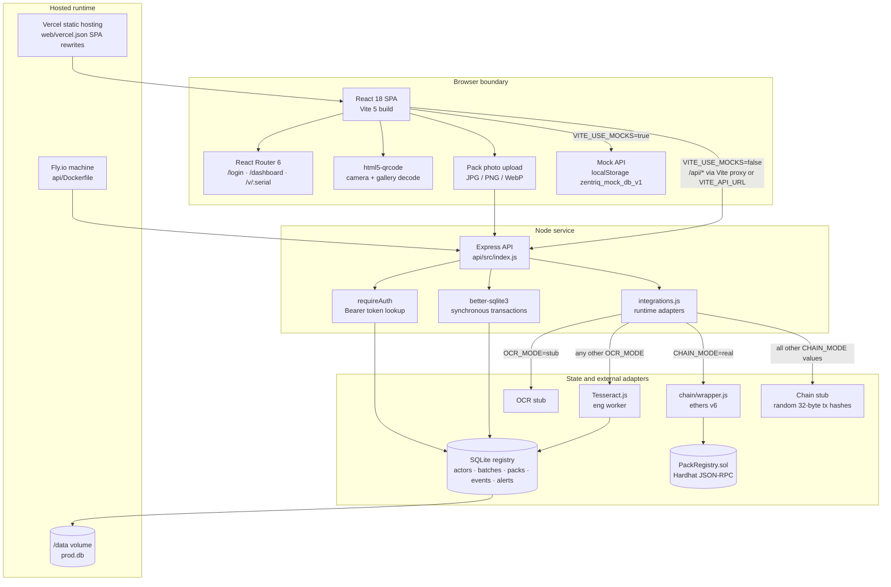
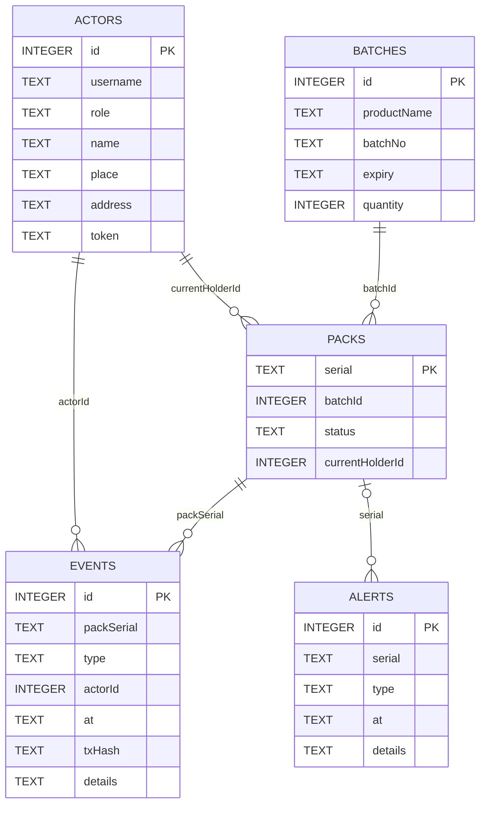
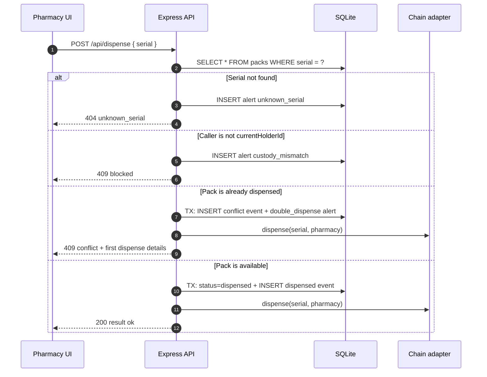
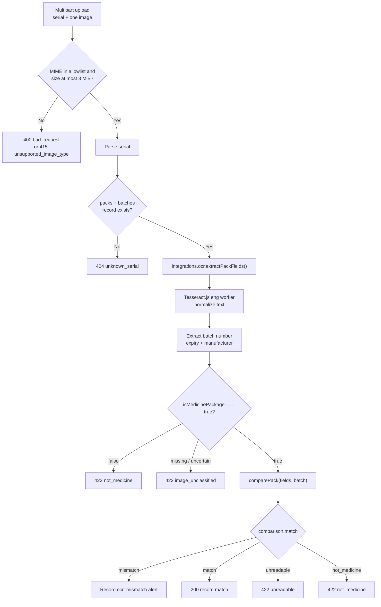
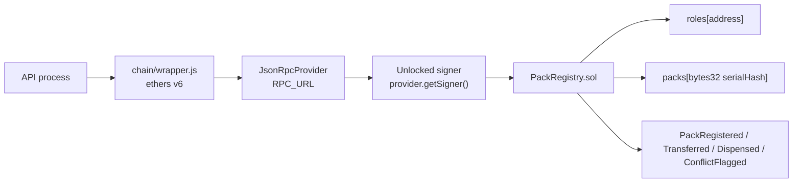
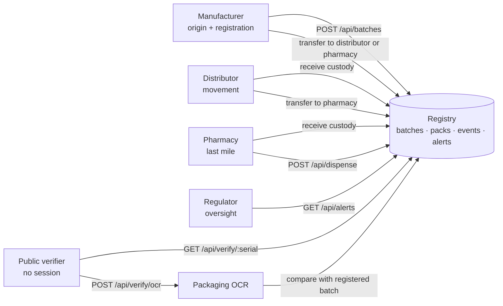
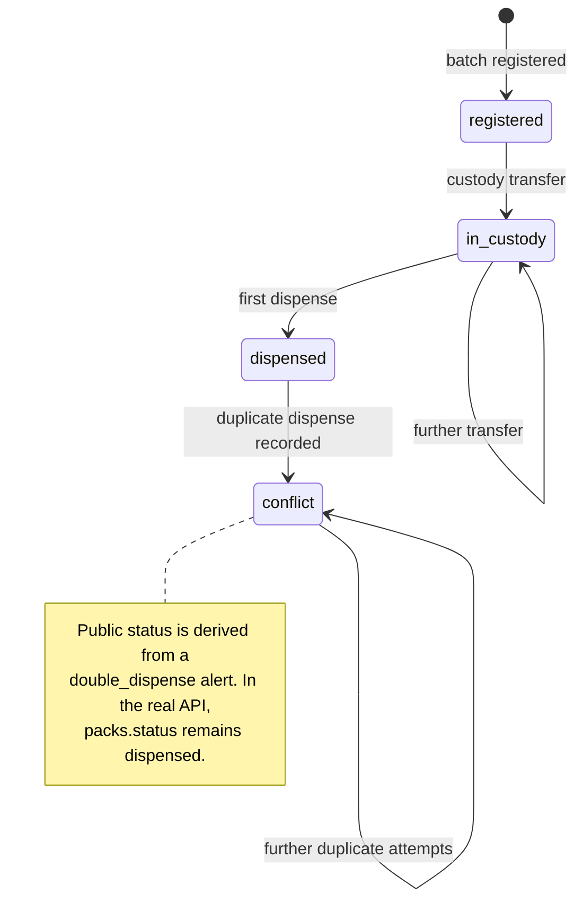

<div align="center">

# ZENTRIQ

**Medicine pack verification for a connected supply chain.**

Registry-backed serials · custody trails · duplicate-dispense detection · packaging OCR · optional EVM audit anchor

[Overview](#1-executive-summary--core-concept) · [Architecture](#2-system-architecture) · [Roles](#3-role--permission-venn--flow) · [Security](#4-cryptographic-security--red-team-defenses) · [Run](#5-local-setup--deployment) · [Authors](#6-authors--copyright)

</div>

> **Scope statement**
>
> ZENTRIQ checks that a pack serial exists in the registry and that the visible batch and expiry fields agree with the stored record. It does not test the medicine inside, establish that a package was manufactured by the named company, or replace laboratory or regulatory inspection.

---

## 1. Executive Summary & Core Concept

### 1.1 The problem

Medicine distribution records are often split across manufacturer systems, distributor manifests, pharmacy point-of-sale software, and paper-based inspection. That fragmentation makes four questions difficult to answer quickly:

1. **Does this pack serial exist in a central registry?**
2. **Which organisation currently holds it, and where?**
3. **Has it already been dispensed, or has a duplicate dispensing event occurred?**
4. **Do the batch number and expiry printed on the box match the registered batch?**

ZENTRIQ answers those questions with a small, inspectable system: a React verification portal, an Express + SQLite registry, a deterministic packaging-OCR path, and an optional blockchain mirror.

### 1.2 How it works

```text
Manufacturer                Distributor                 Pharmacy                 Public / Regulator
    │                            │                         │                            │
    ├─ register batch ───────────►                            │                            │
    ├─ generate 16-char serials  │                         │                            │
    ├─ transfer custody ────────►                            │                            │
    │                            ├─ receive custody         │                            │
    │                            ├─ transfer custody ──────►│                            │
    │                            │                         ├─ verify serial             │
    │                            │                         ├─ dispense (or conflict)    │
    │                            │                         │                            │
    └────────────────────────────┴─────────────────────────┴─ append event + alert ────►│
                                                                                         │
                                              public verification + custody trail ◄──────┘
```

1. A **manufacturer** registers a batch and defines its product name, batch number, expiry, and quantity.
2. The API creates one **16-character pack serial** per unit and records a `registered` event.
3. A **custodian** transfers serials to a distributor or pharmacy; each transfer updates `currentHolderId` and appends a `transferred` event.
4. A **pharmacy** records a `dispensed` event. A repeat attempt is recorded as a conflict and raises a regulator alert.
5. A **public verifier** can look up a serial, inspect the custody trail, and upload a pack photograph for OCR field comparison.

### 1.3 What the system can and cannot answer

| It can answer | It cannot answer |
| --- | --- |
| Whether a serial has a registry record | Whether the medicine inside the pack has the labelled composition |
| The registered product, batch, and expiry | Whether the pack was physically produced by the named manufacturer |
| The current custodian and the recorded event trail | Whether a photograph or QR label has been copied from another pack |
| Whether a duplicate dispensing attempt was recorded | Whether a distributor or pharmacy is licensed in the real world |
| Whether readable batch and expiry text match the registry | Whether a pack has been stored under correct temperature conditions |
| Whether a serial is registered but has no custody movement yet | Whether the supply chain actor is who they claim to be beyond the demo session |

The public UI carries the same boundary in `web/src/strings.json`:

> “This check confirms a pack matches a registry record. It does not test the medicine inside.”

### 1.4 Design principles

| Principle | Implementation consequence |
| --- | --- |
| **Registry first** | SQLite is the operational source of truth. Blockchain writes are optional mirrors and do not decide API responses. |
| **Explicit state** | Packs move through `registered → in_custody → dispensed`; duplicate attempts produce `conflict` events and `double_dispense` alerts. |
| **Deterministic comparison** | OCR extraction is probabilistic, but comparison is a deterministic field check against the registered batch. |
| **Fail closed on uploads** | The OCR route refuses images that are not explicitly classified as medicine packaging. |
| **Small operational surface** | One API process, one SQLite file, one optional chain adapter, and one optional OCR worker. |
| **Demo-compatible defaults** | The frontend runs without a backend through a localStorage mock; the API seeds demo actors on first boot. |
| **Honest limits** | The UI, API, and this document distinguish registry matching from laboratory testing. |

### 1.5 Status lexicon

The UI and API intentionally use a narrow vocabulary. These labels are the product language; the underlying values are in the second column.

| Product label | API / storage value | Meaning |
| --- | --- | --- |
| **Registered by manufacturer** | `registered` | The pack serial exists and the manufacturer still holds it. |
| **In the supply chain, not yet dispensed** | `in_custody` | At least one custody transfer has been recorded; no dispense event exists. |
| **Dispensed** | `dispensed` | A pharmacy recorded a dispensing event. |
| **Conflict: needs review** | `conflict` | A `double_dispense` alert exists. In the real API this is a derived status; the pack row itself remains `dispensed`. |
| **No registered record found** | `unknown` | The serial does not exist in `packs`, or no record was returned. |
| **OCR Mismatch** | `mismatch` | Readable batch or expiry fields differ from the registered record. |
| **OCR Mismatch / unreadable** | `unreadable` | Required fields or confidence were insufficient for comparison. |

### 1.6 Personas

| Persona | Session required | Primary job |
| --- | --- | --- |
| **Manufacturer** | Yes | Register batches, create serials and QR codes, start custody. |
| **Distributor** | Yes | Scan or enter serials, receive stock, dispatch to pharmacies. |
| **Pharmacy** | Yes | Verify a serial, record dispensing, surface duplicate-dispense conflicts. |
| **Regulator** | Yes | Review the national alert feed and open linked pack records. |
| **Public verifier** | No | Look up a serial, inspect its trail, and compare a pack photo. |

The four session-gated personas map to `actors.role`. The public verifier has no actor row and no session.

---

## 2. System Architecture

### 2.1 Topology



**Operational reading of the diagram**

- The browser can run entirely against `web/src/mocks`; no API is required for a UI demo.
- When mocks are disabled, calls go to relative `/api/...` paths. Vite proxies those to `http://localhost:3001`; a deployed frontend uses `VITE_API_URL` as an origin.
- The API always talks to SQLite. Chain synchronization is a post-write side effect, not a second source of truth.
- OCR runs inside the API process through a lazily initialized Tesseract worker. The standalone `ocr/` package is a separate Gemini experiment and is not imported by `api/src`.
- The Docker image and Fly configuration set `CHAIN_MODE=stub` and `OCR_MODE=stub`. The chain contract is not shipped in the API image.

### 2.2 Runtime components

| Component | Path | Responsibility |
| --- | --- | --- |
| Verification portal | `web/` | Login, role dashboards, QR scanning, public verification, OCR upload, mock API. |
| HTTP API | `api/src/index.js` | Session lookup, batch registration, custody transfer, dispensing, public verification, OCR upload, alerts, error handling. |
| Schema and seed actors | `api/src/schema.js` | Table DDL, table list, six demo actors, first-boot initialization. |
| OCR adapter | `api/src/ocr-tesseract.js` | Tesseract worker, text normalization, field extraction, classification, comparison. |
| Integration selector | `api/src/integrations.js` | Selects chain and OCR adapters from environment variables at module load. |
| Chain stub | `api/src/stubs/chain.js` | Returns random 32-byte transaction hashes without an EVM node. |
| OCR stub | `api/src/stubs/ocr.js` | Returns a dummy extraction payload. Note: the API’s classification gate rejects it. |
| Smart contract | `chain/contracts/PackRegistry.sol` | Relayer-controlled pack registry with role mapping, custody, dispensing, and conflict events. |
| Chain wrapper | `chain/wrapper.js` | Converts serials to `keccak256` bytes32 values and calls the local deployment. |
| Chain deploy script | `chain/deploy.js` | Deploys the contract, registers demo actor addresses, writes `deployments.json`. |
| Standalone OCR module | `ocr/` | Gemini-based extraction and comparison experiment; not wired into the API. |
| Demo evidence | `demo/` | Script, evidence log, slide outline, pack-design fixtures. |

### 2.3 Data model



> **Important:** these are logical relationships. `api/src/schema.js` declares **no `FOREIGN KEY` constraints** and no secondary indexes. The only hard constraints are `actors.id` and `batches.id` primary keys, `packs.serial` primary key, and the two auto-increment event/alert IDs. Referential integrity is maintained by application code.

#### Table reference

| Table | Key fields | Purpose |
| --- | --- | --- |
| `actors` | `id`, `username`, `role`, `name`, `place`, `address`, `token` | Demo supply-chain organisations and their current session token. |
| `batches` | `id`, `productName`, `batchNo`, `expiry`, `quantity` | Registered batch metadata. There is no manufacturer column. |
| `packs` | `serial`, `batchId`, `status`, `currentHolderId` | One row per physical pack identity. `serial` is the human-readable 16-character identifier. |
| `events` | `packSerial`, `type`, `actorId`, `at`, `txHash`, `details` | Append-only trail for registration, transfer, dispensing, and conflict events. |
| `alerts` | `serial`, `type`, `at`, `details` | Regulator-facing risk records. |

#### Event types

| Type | Written by | Notes |
| --- | --- | --- |
| `registered` | Batch registration | One row per generated serial. `txHash` is filled after a chain call succeeds. |
| `transferred` | Custody transfer | `details` contains `{"to": <recipientActorId>}`. |
| `dispensed` | First successful dispense | One per pack under normal operation. |
| `conflict` | Duplicate dispense path | Written when the recorded current holder tries to dispense an already-dispensed pack. |

#### Alert types

| Type | Trigger | Details |
| --- | --- | --- |
| `unknown_serial` | Pharmacy dispenses an unregistered serial. | `null` |
| `custody_mismatch` | A pharmacy attempts to dispense a pack it does not currently hold. | `null` |
| `double_dispense` | The current holder attempts a second dispense. | `null` |
| `ocr_mismatch` | OCR comparison returns `mismatch`. | JSON containing `differences`. |

#### Status derivation on public verification

`GET /api/verify/:serial` does not trust `packs.status` alone:

1. If any `double_dispense` alert exists for the serial → `conflict`.
2. Else if `packs.status = dispensed` → `dispensed`.
3. Else if `packs.status = in_custody` → `in_custody`.
4. Else if `packs.status = registered` → `registered`.
5. Else → `unknown`.

The real API never stores the literal status `conflict` in `packs.status`. The mock API does. This difference matters when comparing test fixtures.

### 2.4 HTTP API surface

All responses are JSON except the OCR request, which is multipart. The API enables `cors()` for all origins and accepts JSON bodies up to **1 MB**. Error responses use the shape `{ "error": string, "message": string, ...extra }`, except dispense responses that intentionally return domain results.

| Method | Path | Session | Request | Success | Main failures |
| --- | --- | --- | --- | --- | --- |
| `POST` | `/api/login` | Public | `{ username }` | `200 { token, actor }` | `400` missing username; `401` unknown user |
| `POST` | `/api/batches` | Bearer | `{ productName, batchNo, expiry, quantity }` | `201 { batchId, serials[] }` | `400` validation; `403` not manufacturer; `500` database error |
| `POST` | `/api/custody/transfer` | Bearer | `{ serials[], toActorId }` | `200 { ok, transferred, txHashes[] }` | `400` validation/self-transfer; `403` not holder; `404` unknown serial; `409` already dispensed |
| `POST` | `/api/dispense` | Bearer | `{ serial }` | `200 { result: "ok", txHash, flags }` | `400` missing serial; `403` not pharmacy; `404` unknown serial; `409` blocked/conflict |
| `GET` | `/api/verify/:serial` | Public | Path parameter | `200` record or unknown record | `400` empty serial |
| `POST` | `/api/verify/ocr` | Public | Multipart `serial` + `image` | `200` comparison result | `400` missing file/serial; `404` unknown serial; `415` unsupported image; `422` not medicine/unreadable; `502` OCR unavailable/invalid |
| `GET` | `/api/alerts` | Bearer | Optional `?limit=` | `200` alert array | `403` not regulator |

**Session model**

- `POST /api/login` accepts a username only. There is no password field, password hash, or JWT.
- The API creates `crypto.randomUUID()` and stores it directly in `actors.token`.
- `Authorization: Bearer <token>` is looked up against that column on every gated request.
- Logging in again replaces the previous token for that actor.
- The frontend stores the token and actor in both `zentriq_token`/`zentriq_actor` and `token`/`actor` localStorage keys for compatibility.

**Role gates implemented by the API**

| Route | Gate |
| --- | --- |
| Batch registration | `actor.role === "manufacturer"` |
| Dispense | `actor.role === "pharmacy"` |
| Alerts | `actor.role === "regulator"` |
| Custody transfer | Valid session, valid recipient role, current holder, not already dispensed. The **sender role is not checked**. |

**Validation bounds**

| Input | Bound |
| --- | --- |
| Batch quantity | Whole number from `1` to `10000` |
| Transfer batch | `1` to `500` serials; no duplicate strings; no empty strings |
| Transfer recipient | Existing actor whose role is `distributor` or `pharmacy`; not the sender |
| Alerts limit | Parsed integer clamped to `1..1000`; default `200` |
| OCR image | One file; `image/jpeg`, `image/png`, or `image/webp`; maximum `8 MiB`; memory storage |

### 2.5 Serial identity and entropy

`generateSerial()` in `api/src/index.js` is intentionally small:

```js
const alphabet = "0123456789ABCDEFGHJKMNPQRSTVWXYZ";
const bytes = crypto.randomBytes(16);
let serial = "";
for (let i = 0; i < 16; i += 1) {
  serial += alphabet[bytes[i] % alphabet.length];
}
return serial;
```

| Property | Value |
| --- | --- |
| Random source | Node `crypto.randomBytes(16)` |
| Source entropy | 128 bits (16 bytes) |
| Serial length | 16 characters |
| Alphabet size | 32 symbols: `0123456789ABCDEFGHJKMNPQRSTVWXYZ` |
| Bits per symbol | `log2(32) = 5` |
| Encoded serial space | `32^16 = 2^80` |
| Modulo bias | None for the mapping: `256 % 32 = 0` |
| Collision handling | None in the API generator. A collision would be rejected by the `packs.serial` primary key and surface as `500 database_error`. |
| Forbidden-word filtering | Implemented only in the frontend mock, not in the API generator. |

The API’s 128 source bits are reduced to an **80-bit serial space** by encoding one symbol per random byte. The correct description is “128 bits of random input, 16-character / 80-bit encoded serial,” not “128-bit serial.” The chance of a collision is small for a demo, but there is no retry loop on the server.

The frontend mock uses a different 32-symbol alphabet, `ABCDEFGHJKLMNPQRSTUVWXYZ23456789`, and does retry when a candidate contains a word from `strings.forbiddenWords` or already exists. Mock serials and API serials therefore have different character distributions.

**QR format**

The manufacturer dashboard renders:

```text
${window.location.origin}/v/${serial}
```

Scanners accept either a raw serial or a URL containing `/v/<serial>`, then uppercase the result. The server lookup itself is case-sensitive and only trims whitespace; API clients should send uppercase serials.

### 2.6 Custody and dispense behavior



**Custody transfer** performs all of these checks before writing:

1. `serials` is a non-empty array of at most 500 unique, non-empty strings.
2. `toActorId` is a positive integer and maps to a `distributor` or `pharmacy`.
3. The recipient is not the sender.
4. Every serial exists.
5. `packs.currentHolderId === req.actor.id` for every serial.
6. Every pack’s status is not `dispensed`.

The transfer write is a single `db.transaction()`: it updates `currentHolderId`, sets `status = in_custody`, and inserts one `transferred` event per serial. Chain calls happen after the transaction commits, one per serial. A chain failure is caught and logged; the HTTP response still reports success.

**Dispense ordering detail:** the real API checks current custody **before** checking the dispensed status. A different pharmacy attempting to dispense an already-dispensed pack therefore receives the custody-mismatch path, not the `double_dispense` conflict path. The recorded holder attempting again receives the conflict path. The mock API checks dispensed/conflict status first and does not check the holder at all.

**Chain synchronization is best effort.** Batch registration commits the batch and all packs first, then calls the chain once. Transfer and dispense commit locally first, then call the chain per serial. Chain failures do not roll back SQLite and do not change the success status of the local operation.

### 2.7 OCR pipeline



**Extraction details**

| Stage | Implementation |
| --- | --- |
| Worker | Lazy singleton `createWorker("eng", 1)`; progress logged while recognizing text. |
| Raw text normalization | Uppercase, remove non-printable bytes, collapse spaces. |
| Expected-value assistance | The route passes the registered batch record into extraction; the extractor can use expected batch and expiry to guide parsing. |
| Batch normalization | Uppercase; strip spaces/hyphens; replace `O → 0` and `I → 1`; require `A-Z0-9` length 3–40. |
| Expiry normalization | Supports `YYYY-MM[-DD]`, `DD/MM/YYYY`, `MM/DD/YYYY`, `MM/YYYY`, `MM/YY`, and named-month formats. |
| Manufacturer normalization | Remove parentheses, uppercase, strip non-alphanumerics. |
| Classification | `true` when batch or expiry was extracted (confidence `0.95`); otherwise require at least 2 of 8 packaging signals. |
| Dynamic confidence | `rawConfidence * 0.4 + fieldMatchCount/3 * 0.6`; boosted to at least `0.85` when the batch matches. |
| Comparison threshold | `0.6`. Missing batch, expiry, or registered values produce `unreadable`. |
| Mismatch alert | Only `mismatch` records an alert; `unreadable` and `not_medicine` do not. |

**The classification gate is fail-closed in the route, but the OCR stub does not satisfy it.** `api/src/stubs/ocr.js` returns `{ dummyField, confidence: 1 }` with no `isMedicinePackage` field. The route requires `fields.isMedicinePackage === true`, so a stub-mode upload always returns `422 image_unclassified`. To exercise field comparison, run the API with Tesseract (`OCR_MODE=real` or simply any value other than `stub`) or use frontend mock mode. The Docker image and Fly config default to `OCR_MODE=stub`, so this is the deployed behavior unless changed.

**Manufacturer comparison is currently inert.** `comparePack()` checks `registered.manufacturer`, but `batches` has no `manufacturer` column and the API passes the raw batch row. The extractor can return a manufacturer string, and the comparison code supports one, but the registered side is always `undefined` in the current API path. Batch and expiry are the enforced fields.

**OCR is not an assay.** It compares visible text with a stored row. A copied label, a high-quality reprint, or a clear photograph of another pack can still produce a field match. The system does not inspect composition, potency, or physical security features.

### 2.8 Blockchain audit overlay

The Solidity contract is a **relayer-controlled mirror**:



| Contract feature | Behavior |
| --- | --- |
| `Role` enum | `None`, `Manufacturer`, `Distributor`, `Pharmacy`, `Regulator`. |
| `relayer` | Set to the deployer. All state-changing functions are `onlyRelayer`. |
| `addActor` | Relayer assigns an EVM address a role. |
| `registerPacks` | Relayer registers `bytes32[]` serial hashes; rejects duplicate hashes. |
| `transfer` | Requires registered, not dispensed, current holder equals `from`, and recipient is a distributor or pharmacy. |
| `dispense` | Requires a pharmacy role. First call records the dispenser; later calls emit `ConflictFlagged` and return `false`. |
| `getPack` | Returns `registered`, `holder`, `dispensedBy`, `dispensedAt`. |

The wrapper hashes readable serials with `ethers.id(serial)` (keccak256 of the UTF-8 string). Raw serials are not stored on-chain. The deployment script writes `deployments.json` at the repository root and the wrapper reads only `deployments.localhost`, so the current real-chain path is local-Hardhat-oriented despite the existence of a Sepolia network entry in `hardhat.config.js`.

`CHAIN_MODE=real` loads `chain/wrapper.js`; every other value loads the stub. The Fly image does not copy `chain/`, so `CHAIN_MODE=real` in that image would fail at require time. This is why `fly.toml` pins `CHAIN_MODE=stub`.

The API does not reconcile chain state back into SQLite. If the chain rejects or misses an event, the local database remains authoritative and the UI continues to use it. Chain results are audit metadata, not a consensus gate.

### 2.9 Frontend architecture

| Area | Implementation |
| --- | --- |
| Build | Vite 5, React 18, `@vitejs/plugin-react`. |
| Routing | React Router 6, browser history. |
| Styling | Hand-authored `styles.css`, precompiled Tailwind utility output in `portal.css`, compatibility overrides in `index.css`. No Tailwind package or Tailwind build step is present in `web/package.json`. |
| Icons | `lucide-react`. |
| QR generation | `qrcode.react` (`QRCodeSVG`) in the manufacturer dashboard. |
| QR reading | `html5-qrcode` with camera and gallery-file decode. |
| Sessions | localStorage; `AuthProvider` keeps React state in sync. |
| Data access | Single `web/src/api.js` facade; switches between mock and HTTP calls. |
| Mocks | `web/src/mocks/index.js`, seeded by `web/src/mocks/seed.js`, persisted at `zentriq_mock_db_v1`. |

**Routes**

| Path | Component | Behavior |
| --- | --- | --- |
| `/` | `Home` | Redirects to `/dashboard` when a stored actor and token exist, otherwise `/login`. |
| `/login` | `Login` | Username-only demo login with four quick-login accounts. |
| `/dashboard` | `Dashboard` | Reads the stored actor and renders the role-specific dashboard. |
| `/verify` | `PublicVerify` | Empty public verification page. |
| `/verify/:serial` | `PublicVerify` | Loads a record by route parameter. |
| `/v/:serial` | `PublicVerify` | Short QR-friendly alias used by generated QR codes. |
| `/manufacturer`, `/distributor`, `/pharmacy`, `/regulator` | Redirect | All redirect to `/dashboard`. |
| `*` | Redirect | Redirects to `/`. |

`App.jsx` imports `SerialEntry.jsx`, but no route mounts it. The active pages are `Login`, `Dashboard`, and `PublicVerify`; the role experience lives in `web/src/components/*Dash.jsx`.

**Role dashboards**

| Dashboard | Implemented actions |
| --- | --- |
| Manufacturer | Register batch, generate 16-character serials, render and print QR cards, transfer custody, view persisted batch/log history. |
| Distributor | Auto-start camera scanner, upload a QR image, manually add serials, maintain a transfer queue, dispatch to a pharmacy, view session activity. |
| Pharmacy | Auto-start camera scanner, upload a QR image, manually enter a serial, dispense, show a full-screen conflict dialog with the prior dispenser and time. |
| Regulator | Fetch `/api/alerts`, sort newest first, render type/time/details/serial with links to `/v/:serial`. |

**Public verification page**

- Accepts a 16-character serial, a QR scan, or a `/v/<serial>` URL.
- Shows status, product, current custody, event timeline with transaction hashes, and registry flags.
- Supports camera capture or gallery selection for the OCR upload.
- Uses a pre-flight `navigator.mediaDevices.getUserMedia` capability check and releases the scanner on modal close/unmount.
- The status banner defaults to “No registered record found” before a query is made; this is the page’s initial render state, not a server response.

### 2.10 Mock mode versus the real API

The mock is a UI demo, not an authorization emulator. These differences are intentional enough to document because a demo that passes in mock mode may behave differently against the API.

| Behavior | Real API | Browser mock |
| --- | --- | --- |
| Default activation | Requires a running process. | `VITE_USE_MOCKS !== 'false'`, so mocks are on unless explicitly disabled. |
| Session storage | `actors.token` in SQLite. | `db.sessions[token]` inside localStorage-backed mock DB. |
| Login matching | Exact username after trim. | Lowercased lookup against `DEMO_USERNAMES`. |
| Batch quantity | `1..10000`. | `1..500`. |
| Batch role | Manufacturer only. | Manufacturer only. |
| Transfer sender role | Not checked; sender must currently hold each serial. | Only a valid session is checked; no holder or sender-role check. |
| Transfer recipient | Must be distributor/pharmacy and not self. | Any existing actor; no role or self check. |
| Transfer result | Errors for unknown/not-held/dispensed serials. | Silently skips unknown, dispensed, or conflict records. |
| Dispense holder check | Required before dispensing. | Not checked. |
| Conflict ordering | Holder check happens before dispensed check. | Dispensed/conflict check happens first. |
| Conflict storage | `packs.status` stays `dispensed`; status is derived from `double_dispense` alert. | `rec.status = 'conflict'` is stored directly. |
| Alerts endpoint | Regulator role required. | No role check. |
| OCR | Tesseract extraction plus deterministic comparison. | Caller selects `match`, `mismatch`, or `unreadable`; no image analysis. |
| Serial generator | 16 random bytes, API alphabet, no retry. | 16 random bytes, mock alphabet, retry on forbidden words/collisions. |
| Seed data | Six actors, no packs. | Two seeded packs and one alert. |
| Seed usernames | `zenocare`, `afyalink`, `mlimani`, `kaaga`, `lakeview`, `regulator`. | Adds `kilimo` and `highland` aliases; quick-login shows four. |

Mock seed serials:

| Serial | Seeded state | Holder |
| --- | --- | --- |
| `K7Q2M9XW4TBH3N8D` | `in_custody` | Mlimani Pharmacy |
| `R4T8V2YC6DJH9PXM` | `conflict` with `double_dispense` alert | Mlimani Pharmacy |

### 2.11 Repository and source map

```text
medicine-verify/
├── api/                    Express + SQLite registry, OCR adapter, stubs, seed scripts
├── chain/                  Hardhat project, PackRegistry contract, wrapper, tests
├── demo/                   Demo script, evidence template, pack designs
├── ocr/                    Standalone Gemini OCR experiment and comparison tests
├── spec/                   Empty API/chain/OCR placeholders plus shared strings
├── web/                    React/Vite verification portal
├── .env.example            Root environment template (not auto-loaded by the API)
├── fly.toml                Fly.io API deployment with SQLite volume
└── README.md               This document
```

| Question | Look at |
| --- | --- |
| How is a serial generated? | `api/src/index.js` → `generateSerial()` |
| How is login handled? | `api/src/index.js` → `POST /api/login`, `requireAuth` |
| How is custody transferred? | `api/src/index.js` → `POST /api/custody/transfer` |
| How is a conflict detected? | `api/src/index.js` → `POST /api/dispense`, `GET /api/verify/:serial` |
| How is OCR classified? | `api/src/ocr-tesseract.js` → `classifyMedicinePackage()` |
| How are fields compared? | `api/src/ocr-tesseract.js` → `comparePack()` |
| What tables exist? | `api/src/schema.js` |
| How does the frontend choose data? | `web/src/api.js` → `USE_MOCKS` |
| What does the mock seed contain? | `web/src/mocks/seed.js` |
| How does the contract enforce custody? | `chain/contracts/PackRegistry.sol` |
| How does the API call the chain? | `chain/wrapper.js`, `api/src/integrations.js` |
| How is the API deployed? | `api/Dockerfile`, `fly.toml` |
| How is the frontend deployed? | `web/vercel.json`, `web/vite.config.js` |

---

## 3. Role & Permission Venn / Flow

### 3.1 Role flow



### 3.2 Capability matrix

| Capability | Public | Manufacturer | Distributor | Pharmacy | Regulator |
| --- | :---: | :---: | :---: | :---: | :---: |
| Log in with a demo username | — | Yes | Yes | Yes | Yes |
| Register a batch and generate serials | — | **Yes** | — | — | — |
| Hold custody | — | Yes, at origin | Yes | Yes | — |
| Transfer custody | — | Holder only | Holder only | Holder only via API | — |
| Dispense a pack | — | — | — | **Yes** | — |
| Read public pack record and trail | **Yes** | Yes | Yes | Yes | Yes |
| Upload a pack photo for OCR comparison | **Yes** | Yes | Yes | Yes | Yes |
| Read the alert feed | — | — | — | — | **Yes** |
| See regulator alerts in a dashboard table | — | — | — | — | **Yes** |
| Mutate a pack record | — | Register/transfer | Transfer | Dispense | — |

### 3.3 Boundary overlaps and gaps

The roles overlap in ways that matter for both UX and security review:

| Overlap | What actually happens |
| --- | --- |
| **Manufacturer ∩ Distributor: transfer** | Both can call the transfer endpoint. The API does not check the sender’s role; it checks that the sender currently holds each serial. |
| **Distributor ∩ Pharmacy: receiving** | Both are valid recipients. A distributor can transfer to another distributor or a pharmacy; a manufacturer can also transfer directly to a pharmacy. |
| **Pharmacy ∩ Public: verification** | A logged-in pharmacy can use the public verification page; the public endpoints need no session. |
| **Regulator ∩ Public: record inspection** | Regulator alert rows link to `/v/:serial`, which is the same public page. Regulators cannot mutate a pack from the alerts table. |
| **Manufacturer ∩ Registry: origin** | Only a manufacturer can create a batch, but any session-gated current holder can transfer it afterward. |
| **All session-gated roles ∩ Public** | Gated users can call public endpoints; public users cannot call gated endpoints. |
| **Intended path vs enforced path** | The UI presents `Manufacturer → Distributor → Pharmacy`, but the transfer API allows `Manufacturer → Pharmacy` and `Distributor → Distributor`. |
| **Pharmacy transfer gap** | The pharmacy dashboard has no transfer action, but the API would accept a transfer from a pharmacy that is the current holder. Sender-role restrictions are not implemented for transfers. |

**Self-transfer is explicitly rejected.** A holder cannot transfer to its own actor ID. Transfers to a manufacturer or regulator are rejected because the recipient role must be `distributor` or `pharmacy`.

### 3.4 Pack lifecycle



Side paths that do not change the pack state:

- An unknown serial produces a `404` and an `unknown_serial` alert; no pack state exists.
- A non-holder dispense attempt produces a `409 blocked` and a `custody_mismatch` alert; the pack state is unchanged.
- An OCR mismatch produces an `ocr_mismatch` alert; the pack status is unchanged.
- A chain failure produces a log entry; SQLite state is unchanged from the API’s perspective.

### 3.5 Boundary of the public experience

The public page is deliberately read-mostly. It can:

- look up a serial,
- display product and current holder,
- display the chronological trail,
- display registry flags,
- compare a photo against the registered batch fields.

It cannot:

- register, transfer, or dispense,
- see the regulator alert feed as a list,
- distinguish a copied QR label from an original one,
- prove that the photographed pack is the same physical unit as the serial.

### 3.6 Demo accounts

The API seeds six actors on first database initialization. The login screen exposes four quick-login buttons; the other two are available by typing their usernames.

| Username | Actor ID | Role | Name | Place |
| --- | ---: | --- | --- | --- |
| `zenocare` | 1 | Manufacturer | Zenocare Labs (demo) | Nairobi |
| `afyalink` | 2 | Distributor | AfyaLink Distributors (demo) | Nairobi |
| `mlimani` | 3 | Pharmacy | Mlimani Pharmacy (demo) | Meru |
| `kaaga` | 4 | Pharmacy | Kaaga Chemist (demo) | Meru |
| `lakeview` | 5 | Pharmacy | Lakeview Pharmacy (demo) | Kisumu |
| `regulator` | 6 | Regulator | Demo Regulator | Nairobi |

No password is required by design. The API source contains an explicit comment that username-only session handling is not suitable for production.

### 3.7 Role-specific UI behavior

| UI surface | Important behavior |
| --- | --- |
| Login | Four quick-login buttons plus free-text username. A stored actor redirects to `/dashboard`. |
| Dashboard shell | Reads `actor`/`zentriq_actor` from localStorage, renders the matching dashboard, and clears localStorage on logout. |
| Manufacturer | Persists created batches and logs in localStorage so a reload can repopulate the transfer form. QR values point at `/v/<serial>`. |
| Distributor | Camera auto-starts on mount. The queue only accepts 16-character normalized serials. Transfer recipient defaults to actor 3. |
| Pharmacy | Camera auto-starts. A successful dispense increments a session counter; a conflict opens a blocking modal with the prior dispenser and time. |
| Regulator | Pulls the alert feed on mount. Alert types are mapped through `web/src/lib/lexicon.js`. |
| Public | Search/scan/photo. The pack-photo section is always rendered, but an upload is rejected until a current serial has been resolved. |

